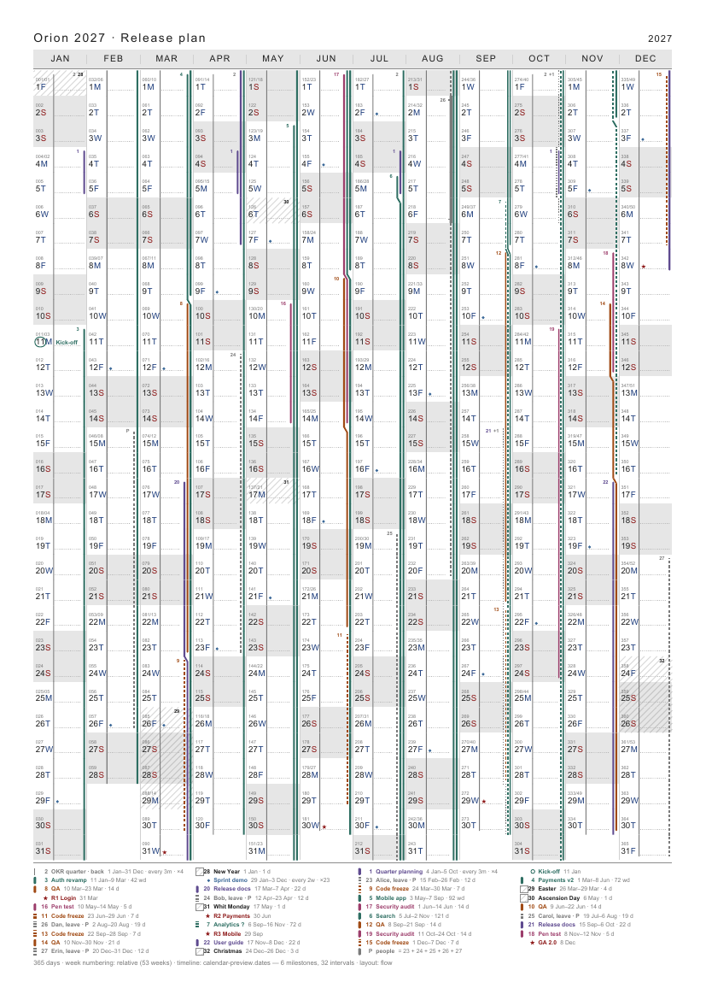
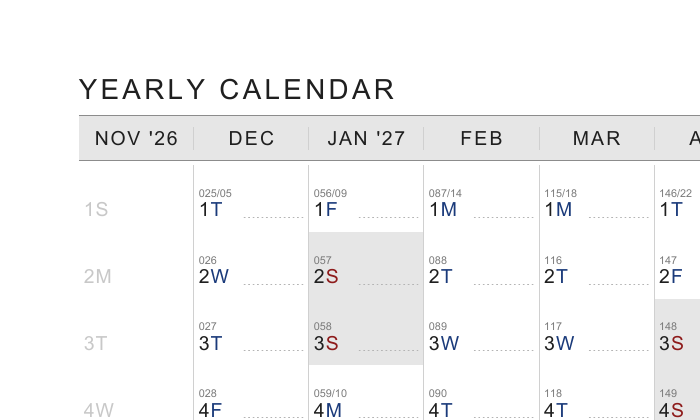
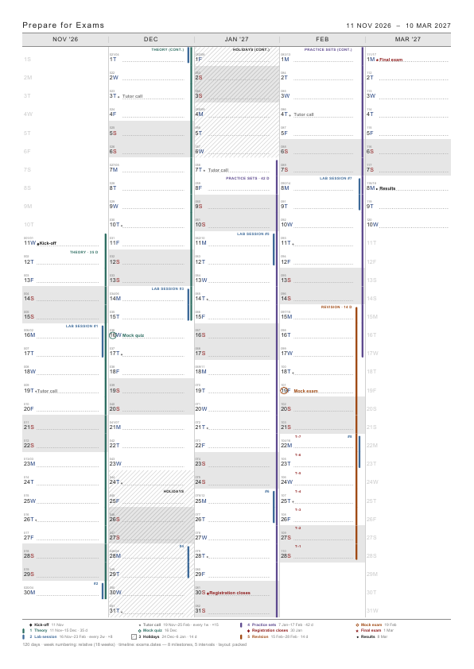
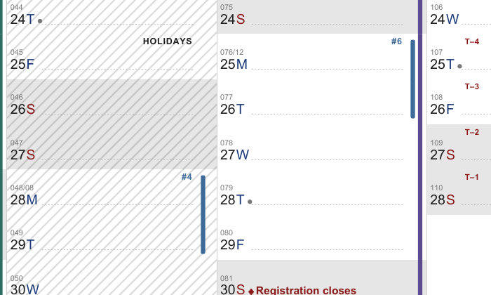

# A4 annual calendar

A one-page calendar to print: a column for every month, a row for every day, and room
for a note beside each date. A4 or US Letter, a full year by default, or any shorter
period from one day up.



It is a single binary for Windows or Linux that needs nothing installed. Download, build and
run instructions are in [go/README.md](go/README.md).

## What is on the page



- **Title** at the top left, and the period at the top right. A period from 1 January to
  31 December shows just the year.
- **Month columns.** Every month the period touches gets a column: 12 for a year that
  starts on the 1st, 13 otherwise. A column that starts a new year says so (`JAN '27`).
- **Day cells.** The day number and weekday letter (`7S`), with the weekday letter blue
  on workdays and red at weekends. Above them in small type is the day of the period
  and the week number (`001/01`). A dotted guide line fills the rest of the cell for notes.
- **Weekends** are shaded.
- **Days outside the period** in a month the period touches are drawn faint, or left out
  with `--hide-outside`.
- **Footer**: the number of days and how weeks are counted.
- **Milestones and intervals**, if you give any: marks, titles and coloured rails on the
  cells, and a legend under the grid ([below](#milestones-and-intervals)).

## Quick start

```sh
yearly-calendar                                # one year from today
yearly-calendar --start 2027-01-01             # calendar year 2027 -> calendar_2027-01-01.pdf
yearly-calendar --start 2026-11-07 --period 90d -o q4.pdf
```

The file is written to the current directory as `calendar_<start>.pdf`, or
`calendar_<start>_<period>.pdf` for a period shorter than a year, unless `-o` names it.

## Period

`--period` sets the length, counted from `--start`:

| Value | Covers | Example from 2026-11-07 |
|---|---|---|
| `<N>d` | N days | `90d` → to 2027-02-04 |
| `<N>w` | N × 7 days | `2w` → to 2026-11-20 |
| `<N>m` | to the same day N months later, minus a day | `3m` → to 2027-02-06 |
| `1y` | one year (the default) | → to 2027-11-06 |

One year is the maximum: `53w`, `13m` or `400d` are refused. When the target day does not
exist (31 January + 1 month), the period runs to the end of the shorter month.

The default title follows the period: `YEARLY CALENDAR` for `1y`, otherwise for example
`90-DAY CALENDAR`. A title too long to fit beside the period label is cut with `...`.

## Milestones and intervals

The calendar can carry a timeline: **milestones** (single days) and **intervals** (spans of
days), written in a small date language, inline or in a `.dates` file.



```sh
yearly-calendar --start 2026-11-11 --period 120d --file exams.dates --title "Prepare for Exams"
yearly-calendar --milestone 'release=2027-03-15;title="Release"' \
                --interval  'qa=@release-2w/@release;title="Final QA";color=orange'
```

In **Windows PowerShell 5.1** the double quotes inside an argument are lost, so a title
with a space fails. Put `--%` before the arguments and escape the quotes with a backslash.
After `--%` PowerShell passes the line on unchanged and no longer expands `$variables`:

```powershell
& .\yearly-calendar.exe --% --milestone "release=2027-03-15;title=\"Release\"" --interval "qa=@release-2w/@release;title=\"Final QA\""
```

PowerShell 7.3 and later and Unix shells need none of this, and a `.dates` file avoids
shell quoting altogether.

A `.dates` file has one declaration per line; `#` starts a comment:

```
kickoff  = today;           title="Kick-off"
exam     = 2027-03-01;      title="Final exam"; mark=star; color=red; countdown=7
tutor    = 2026-11-19;      title="Tutor call"; every=1w; until=@exam; mark=dot
theory   = @kickoff/5w;     title="Theory"; color=teal; length=days
practice = @theory.end/3w;  title="Practice"; color=violet
labs     = 2026-11-16/2d;   title="Lab session"; every=2w; count=8; color=steel
lastlab  = @labs[-1].start; title="Last lab"; mark=dot
revision = 2w/@exam;        title="Revision"; color=orange
```

- **Dates**: `2027-03-15`, `today`, or a reference to something declared earlier, each
  optionally shifted: `@exam-30d`, `today+2w`. Units are `d`, `w`, `m` and `y`; months keep
  the day or stop at the month's end.
- **References**: `@exam` is a milestone's date; `@theory.start` and `@theory.end` are an
  interval's start and end (the end as written, the day after its last day, so
  `@theory.end/3w` follows straight on). A repeat is referenced by occurrence: `@tutor[3]`
  is the third, `@tutor[-1]` the last (this needs `count` or `until`), and
  `@labs[2].start` the start of the second lab.
- **Intervals** are `START/END`, `START/DURATION` or `DURATION/END`. The end is not
  included: `2027-01-04/2027-01-08` covers 4–7 January. An interval may be anonymous
  (no `name =`).
- **Repeats**: `every=2w` (from the first start) or `gap=1w` (after the previous end), with
  `count=8` or `until=@exam`, or until the end of the page.
- `--today YYYY-MM-DD` sets what `today` means, and is also the default `--start`.

The full language is in [docs/timeline/date-dsl-specification.md](docs/timeline/date-dsl-specification.md).



On the page, milestones get a mark after the weekday letter and their title on the note
line (with 8 or more month columns, mark and a smaller title share the note line, and a
long title is cut with `…`); intervals become vertical rails at the right edge of the cells, labelled at the top
of a cell (or with a numbered key when a column is crowded). Everything drawn is listed in
the legend under the grid, which takes its room from the rows. The footer names the
timeline's files and counts.

Optional keys on a declaration change how it is drawn; any other `key=value` is kept and
ignored:

| Key | Values (default first) | On | Effect |
|---|---|---|---|
| `title` | text | both | label, title and legend text (default: the name) |
| `color` | `ink`, `red`, `teal`, `violet`, `orange`, `steel`, `ochre`, `magenta`, `grey`, `#RRGGBB` | both | colour |
| `mark` | `diamond`, `star`, `dot`, `ring` | milestone | mark; `ring` circles the day number |
| `countdown` | `1`–`99` | milestone | `T–7` … `T–1` on the days before (wide columns only) |
| `style` | `solid`, `dashed`, `hatch` | interval | `hatch`: hatched cells instead of a rail |
| `status` | `confirmed`, `tentative` | both | `tentative`: dashed rail and ` ?` after the title |
| `length` | `days`, `workdays` | interval | adds ` · 14 d` or ` · 10 wd` (workdays skip `--weekend`) |
| `layer` | `front`, `back` | interval | `back`: a thin line beside the day label, no rail |
| `priority` | `normal`, `high`, `low` | interval | who gets a rail first when a column is full |
| `group` | a name | interval | members share one rail on crowded pages (`--timeline-groups`) |
| `hide` | `no`, `yes` | both | `yes`: usable as `@name`, never drawn |
| `label` | `first`, `each`, `none` | both | which occurrences of a repeat get a text label |

An error in a declaration stops the run before anything is written, with one
`file:line: message` per problem and exit code 2.

When a column runs out of room (6 rails on wide columns, 4 or 3 on narrower ones), further
intervals share a dotted grey overflow rail and a grey `+N` counts them; their keys and the
legend still name them. A legend too long for the page drops its dates, then ends with
`+N more` and prints the full list on the terminal.

## Options

| Option | Default | Meaning |
|---|---|---|
| `--start YYYY-MM-DD` | today | first day of the period |
| `--period P` | `1y` | `<N>d`, `<N>w`, `<N>m` or `1y` |
| `-o`, `--output PATH` | `calendar_<start>[_<period>].pdf` | output file |
| `--title TEXT` | from the period | page title; `--title ""` for none |
| `--paper a4\|letter` | `a4` | paper size |
| `--header compact\|full` | `compact` | `full`: a large title and a taller month row |
| `--week-mode relative\|iso\|rolling` | `relative` | how weeks are numbered (below) |
| `--week-start 0..6` | `0` (Monday) | first weekday for `relative` mode |
| `--week-labels first\|all` | `first` | show the week number on its first day, or on every day |
| `--weekend LIST` | `5,6` | weekday indexes to shade, `0`=Monday … `6`=Sunday |
| `--note-lines N` | `1` | dotted guide lines per cell |
| `--no-note-guide` | | no guide lines |
| `--hide-outside` | | leave days outside the period blank instead of faint |
| `--no-footer` | | no footer line |
| `--workday-color #RRGGBB` | `#1A3A7A` | weekday letter on workdays |
| `--weekend-color #RRGGBB` | `#8E1B1B` | weekday letter at weekends |
| `--margin MM` | `10` | page margin in millimetres |
| `--day-letters LLLLLLL` | `MTWTFSS` | weekday letters, Monday first |
| `--month-names A,B,…` | `JAN,…,DEC` | 12 comma-separated month names |
| `--font PATH.ttf` | Helvetica | a TrueType font, needed for non-Latin scripts |
| `--file PATH` | | milestones and intervals from a `.dates` file; repeatable |
| `--milestone DECL` | | one milestone, e.g. `'exam=2027-03-01;title="Exam"'`; repeatable |
| `--interval DECL` | | one interval, e.g. `'qa=@exam-2w/@exam'`; repeatable |
| `--today YYYY-MM-DD` | today | the date `today` stands for |
| `--timeline-layout packed\|flow` | `packed` | `packed`: rails arranged per month; `flow`: rails keep their place across months and close up as intervals end |
| `--timeline-compact daily\|weekly` | `daily` | `flow` only: close up every day, or on `--week-start` |
| `--timeline-lanes auto\|1–12` | `auto` | rails per column before the overflow rail |
| `--timeline-groups auto\|merge\|separate` | `auto` | one rail per `group`; `auto` merges when columns are narrow (A4: 8 or more) |
| `--timeline-legend full\|off` | `full` | the legend under the grid |
| `--version` | | print the version |

`--help` lists them too.

### Week numbering

- **`relative`**: week 01 is the calendar week that contains the start date. Weeks begin on
  `--week-start`.
- **`iso`**: ISO-8601 week of the year.
- **`rolling`**: blocks of seven days counted from the start date.

## Other languages

The built-in Helvetica covers Western European languages only. For Cyrillic or other scripts,
give a TrueType font and the weekday and month names:

```sh
yearly-calendar --start 2027-01-01 --font DejaVuSans.ttf \
    --day-letters "ПВСЧПСН" \
    --month-names "СІЧ,ЛЮТ,БЕР,КВІ,ТРА,ЧЕР,ЛИП,СЕР,ВЕР,ЖОВ,ЛИС,ГРУ" \
    --title "КАЛЕНДАР НА РІК"
```

The binary has PT Sans Narrow built in, which covers Cyrillic: use `--font pt-sans-narrow`
and no font file is needed.

## Versions

Releases follow [Semantic Versioning](DEV.md#versioning). The version is in the
[`VERSION`](VERSION) file. The program reports it with `--version` and writes it into
every PDF it produces (Document Properties → Creator, e.g. `yearly-calendar 0.2.0`).
What changed in each release is in [Release-Notes.md](Release-Notes.md). Downloads are on
the repository's Releases page. How releases are made is in [DEV.md](DEV.md).

## Licences

This project is released under the [MIT License](LICENSE).

The binary also contains third-party work under its own licences. It embeds PT Sans
Narrow (ParaType, SIL Open Font License 1.1). It links
[go-pdf/fpdf](https://github.com/go-pdf/fpdf) (MIT), [spf13/pflag](https://github.com/spf13/pflag)
(BSD-3-Clause) and the Go standard library (BSD-3-Clause).
`yearly-calendar --licenses` prints these licences. Every release archive includes `LICENSE`,
`OFL.txt` and `THIRD_PARTY_LICENSES.txt`.
