# 01 · Requirements (normative)

Keywords MUST, MUST NOT, SHOULD, MAY follow RFC 2119. Each requirement has a stable ID; cite it in code comments, tests and commits.
Pictures referenced here are drawn by the reference renderer from `examples/*.dates`; [04-scenarios.md](04-scenarios.md) has one per case.

Terms used throughout:

| Term | Meaning |
|---|---|
| **Period** | The calendar's printed date range (`--start` + `--period`). |
| **Column** | One month of the period. 1–13 columns. |
| **Cell** | One day in a column. Rows are always 31; days past month end are blank. |
| **Label block** | The existing left part of a cell: tiny `ddd/ww` label + day number + weekday letter. **Unchanged by this feature.** |
| **Note line** | The existing dotted guide on which people write. Its start (`guideStart`) is computed by the existing code. |
| **Rail zone** | A strip on the right of the column reserved for interval rails. The note line ends where the rail zone begins. |
| **Lane** | One vertical rail position inside the rail zone; lane 0 is closest to the column's right edge. |
| **Occurrence** | One dated instance of a milestone or interval; a non-recurring declaration has exactly one. |
| **Series** | All occurrences of one recurring declaration (`every=` or `gap=`). |
| **Wide / narrow page** | Column width ≥ 26.5 mm (A4: 1–7 columns) is *wide*; below that (A4: 8–13 columns) is *narrow*. |

---

## 1. Inputs and command line

| ID | Requirement |
|---|---|
| **REQ-CLI-1** | The application MUST accept the Date DSL inputs exactly as the DSL spec §9 defines them: repeatable `--file PATH`, `--milestone DECL`, `--interval DECL`, loaded in the order files → inline milestones → inline intervals. |
| **REQ-CLI-2** | `--today YYYY-MM-DD` MUST set the evaluation date used for `today` and for relative offsets. Default: the local calendar date, captured once per run. |
| **REQ-CLI-3** | `--timeline-layout packed\|flow` selects the lane layout. Default `packed`. |
| **REQ-CLI-4** | `--timeline-compact daily\|weekly` selects flow compaction (§7). Default `daily`. With `packed` it MUST be ignored with a warning on stderr. |
| **REQ-CLI-5** | `--timeline-lanes auto\|N` (N = 1–12) overrides the lane cap (§6). Default `auto`. |
| **REQ-CLI-6** | `--timeline-groups auto\|merge\|separate` controls group merging (§8). Default `auto` = merge on narrow pages, separate on wide pages. |
| **REQ-CLI-7** | `--timeline-legend full\|off` controls the legend (§10). Default `full` when at least one milestone or interval is drawn. |
| **REQ-CLI-8** | Without any `--file/--milestone/--interval`, output MUST be identical to the current release (no layout, size or metadata change). |
| **REQ-CLI-9** | All timeline options MUST appear in `--help` with the names, defaults and validation given here. |

## 2. Resolution

| ID | Requirement |
|---|---|
| **REQ-RES-1** | Parsing, references, recurrence expansion and DSL errors MUST follow the Date DSL spec. This document adds no syntax. |
| **REQ-RES-2** | Recurrences MUST be expanded only up to the period's last day; unbounded series stop there. Occurrences entirely before the period are resolved but not drawn. |
| **REQ-RES-3** | An interval resolves to the half-open `[start, end)`, where `end` is the day after its last day (DSL §11.3; as written, the end date is included unless `<` precedes it). The **last drawn day** is `end − 1 day`. Every drawing rule below uses the last drawn day. A one-day interval (start = last drawn day) is drawn like any other, one cell long. |
| **REQ-RES-4** | Resolution MUST finish before layout; layout never re-evaluates dates. |

## 3. Rendering keys

The DSL reserves `title`, `every`, `gap`, `count`, `until`. The calendar gives meaning to the keys below; every other key is carried as data and not drawn. Keys and the listed values are case-insensitive.

| ID | Key | On | Values (default **bold**) | Effect |
|---|---|---|---|---|
| **REQ-KEY-1** | `title` | both | text | Milestone title, interval label, legend text. Without it the identifier is used; an anonymous interval without a title shows only its rail and its key. |
| **REQ-KEY-2** | `color` | both | **ink**, red, teal, violet, orange, steel, ochre, magenta, grey (gray), `#RRGGBB` | Mark, title, rail, key colour. See palette in 02 §4. |
| **REQ-KEY-3** | `mark` | milestone | **diamond**, star, dot, ring | Glyph after the weekday letter; `ring` circles the day number instead. |
| **REQ-KEY-4** | `countdown` | milestone | integer 1–99 | Writes `T−N … T−1` in the N in-period days before the milestone (wide pages only). Ignored, with a warning, on a recurring milestone. |
| **REQ-KEY-5** | `style` | interval | **solid**, dashed, hatch | `dashed`: broken rail. `hatch`: diagonal hatching of the cells, no rail, no lane. |
| **REQ-KEY-6** | `status` | both | **confirmed**, tentative | `tentative`: rail drawn dashed (if `style` is solid) and ` ?` appended to the title wherever it is shown. |
| **REQ-KEY-7** | `length` | interval | days, workdays | Appends ` · N d` / ` · N wd` to the first label and the legend. Workdays exclude the days in `--weekend`. (Renamed from `count`, which the DSL reserves.) |
| **REQ-KEY-8** | `layer` | interval | **front**, back | `back`: drawn as a margin line (§5.4), takes no lane. |
| **REQ-KEY-9** | `priority` | interval | low, **normal**, high | Packing order (§6): high is packed first and overflows last; low overflows first. |
| **REQ-KEY-10** | `group` | interval | identifier | Groups members for merging (§8) and legend lines. |
| **REQ-KEY-11** | `hide` | both | yes, **no** | `yes`: resolvable anchor, never drawn, not in the legend. |
| **REQ-KEY-12** | `label` | both | **first**, each, none | Series: `first` titles the first occurrence in each column; `each` titles every occurrence; `none` never shows a text label. On a single occurrence `none` suppresses its text label. Keys (§9) are never suppressed. |
| **REQ-KEY-13** | — | — | — | An unknown **value** for one of these keys MUST be an error naming source, line, key and allowed values. Unknown **keys** MUST be accepted silently. |

## 4. Milestones

| ID | Requirement |
|---|---|
| **REQ-MS-1** | Wide page: the mark glyph is drawn after the weekday letter in the milestone colour; the title is drawn on the note line, left-aligned at `guideStart`, clipped with `…` before the rail zone. A title that would keep fewer than three characters before the `…` is left out (wide and narrow pages). 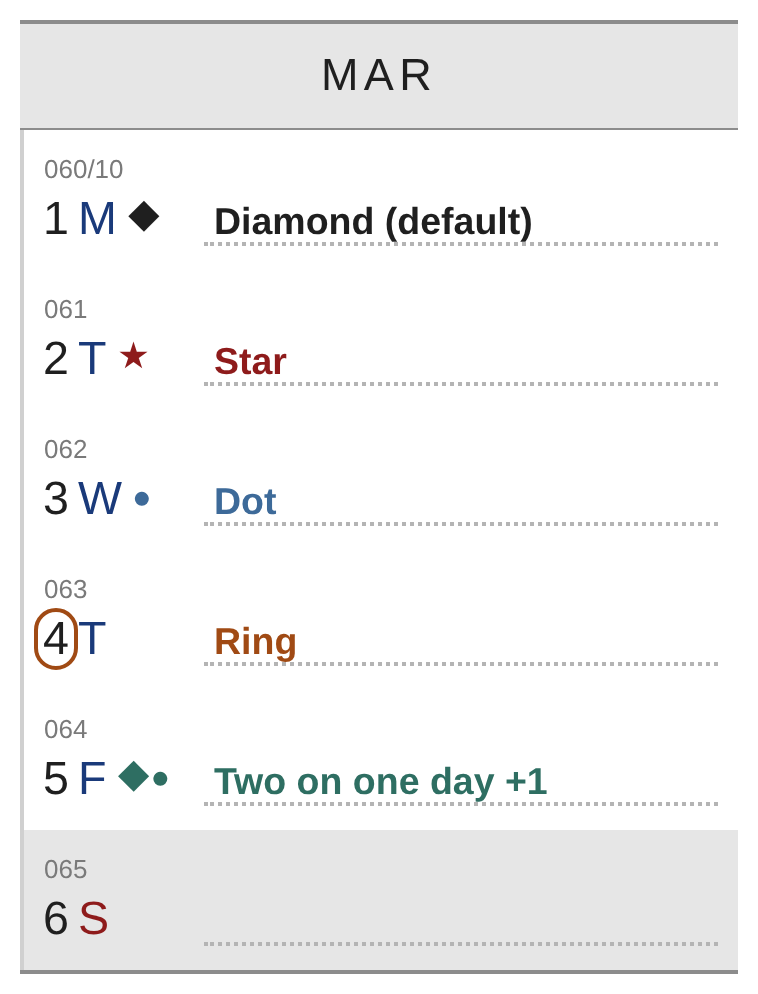 |
| **REQ-MS-2** | `mark=ring` draws a 0.75 pt pill outline around the day number in the milestone colour and no glyph. |
| **REQ-MS-3** | Narrow page: the glyph is drawn at the start of the note line and the title follows it, 1 pt after the glyph, at 4.9 pt, clipped with `…` before the rail zone; the legend carries the full title. |
| **REQ-MS-4** | Several milestones on one day: all glyphs side by side in declaration order; one title — the first that is due a title — followed by ` +N` (N = the other milestones that day). |
| **REQ-MS-5** | Countdown text is drawn top-left in the note area of each countdown day, in the milestone colour. It does not block interval labels. 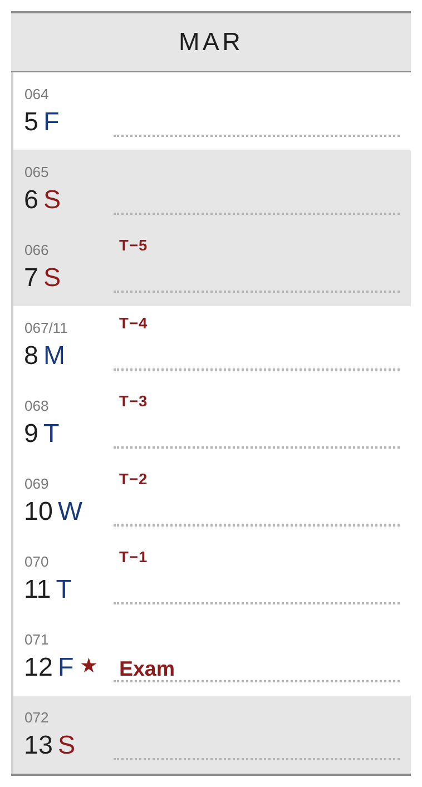 |
| **REQ-MS-6** | A milestone outside the period is not drawn and not listed. |

## 5. Intervals

### 5.1 Rails

| ID | Requirement |
|---|---|
| **REQ-IV-1** | A front interval is a vertical rail in its lane, on every in-period day from start to last drawn day. Lane 0 is `pad` from the column's right edge; each next lane is one `step` further left (02 §3). |
| **REQ-IV-2** | On the start day the rail begins `cap` (3 pt) below the cell top; on the last drawn day it ends `cap` above the cell bottom; both ends are rounded (r = 0.75 pt). Otherwise the rail runs edge to edge so consecutive days join. 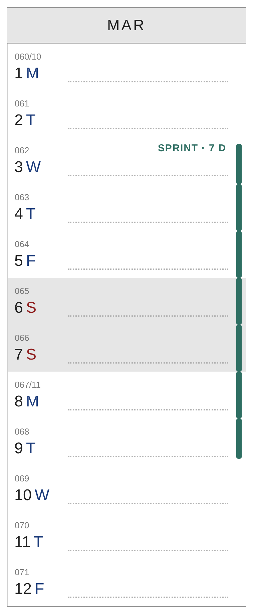 |
| **REQ-IV-3** | Back-to-back intervals (one ends the day the next starts) MUST NOT share a cell; the caps leave a visible gap. 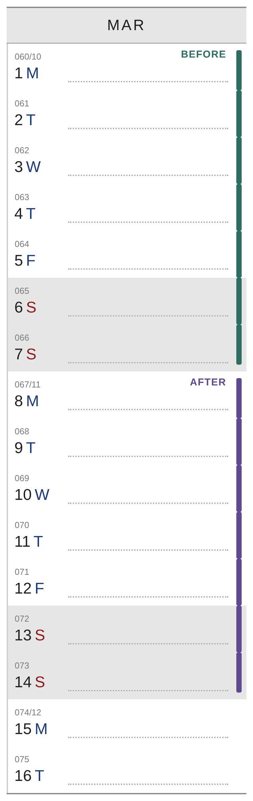 |
| **REQ-IV-4** | A rail continuing into the next column starts flush at the top of day 1; a rail continuing from the previous column ends flush at the bottom of the month's last day. 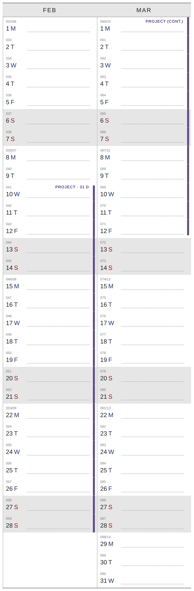 |
| **REQ-IV-5** | Clipped by the period: the clipped end has no cap; the label length and the legend use the full interval. 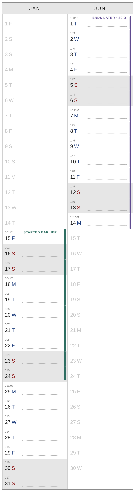 |
| **REQ-IV-6** | `style=dashed` (or `status=tentative`): 2.25 pt dash, 1.5 pt gap, in the rail colour. 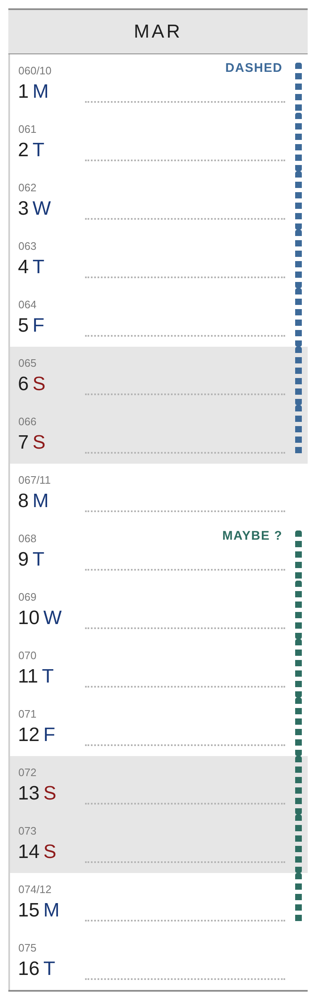 |

### 5.2 Hatch

| ID | Requirement |
|---|---|
| **REQ-IV-7** | `style=hatch` hatches every covered in-period cell: 135° lines, 0.75 pt, pitch 3.75 pt, colour #DBDBDB, drawn over the cell background (weekend grey or white) and under all labels. It takes no lane. 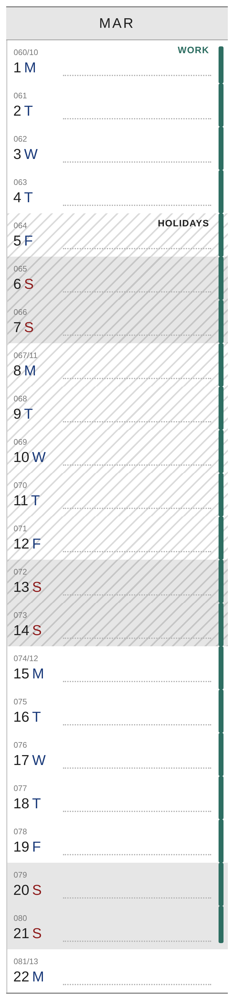 |
| **REQ-IV-8** | Hatch is the only cell-wide treatment. Timelines MUST NOT tint or fill cells. |

### 5.3 Overlap

| ID | Requirement |
|---|---|
| **REQ-IV-9** | Overlapping intervals go to different lanes per §6 (packed) or §7 (flow). 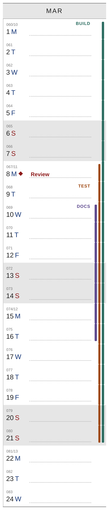 |

### 5.4 Background layer

| ID | Requirement |
|---|---|
| **REQ-IV-10** | `layer=back` is drawn as a 0.75 pt vertical **margin line** 1.5 pt left of `guideStart`, between the label block and the note line, with the same caps as a rail. A second and third back interval on the same day sit 2.25 pt further right each and are dotted (1.5 pt on, 1.5 pt off). More than three on one day: the fourth and later are not drawn (still labelled and in the legend). 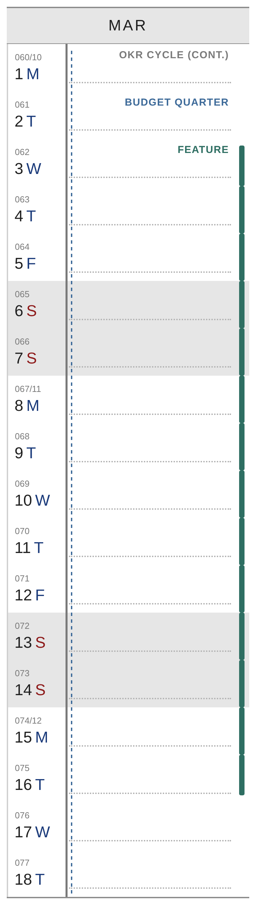 |

## 6. Packed layout (default)

| ID | Requirement |
|---|---|
| **REQ-PK-1** | Lanes are assigned **per column** from the units in that column (03 §2). A unit occupies its lane only on the days it is drawn. |
| **REQ-PK-2** | Units are packed in the order: priority (high, normal, low), first drawn day in the column, declared start, longer first. Each unit takes the lowest lane free on all of its days. |
| **REQ-PK-3** | Lane cap: wide page with column ≥ 31.75 mm → 6; other wide pages → 4; narrow pages → 3; overridable with `--timeline-lanes`. A unit that would need lane ≥ cap goes to the **overflow rail**. 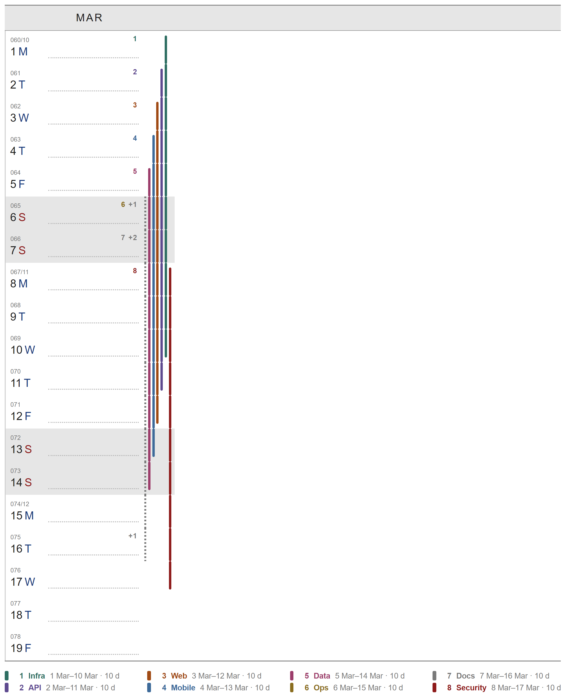 |
| **REQ-PK-4** | Overflow rail: 1.1 pt wide, dotted 1.1 on / 1.1 off, grey #7A7A7A, at the lane index equal to the number of lanes shown, on every day an overflowed unit is active. A grey `+N` (N = overflowed units active that day) is written at the end of the top row wherever N changes. Overflowed intervals keep their keys. |
| **REQ-PK-5** | Rail width and step depend on `k` = lanes shown + 1 if the column has an overflow rail (02 §3). The rail zone width is `pad + k·step + pad`, constant for the whole column. 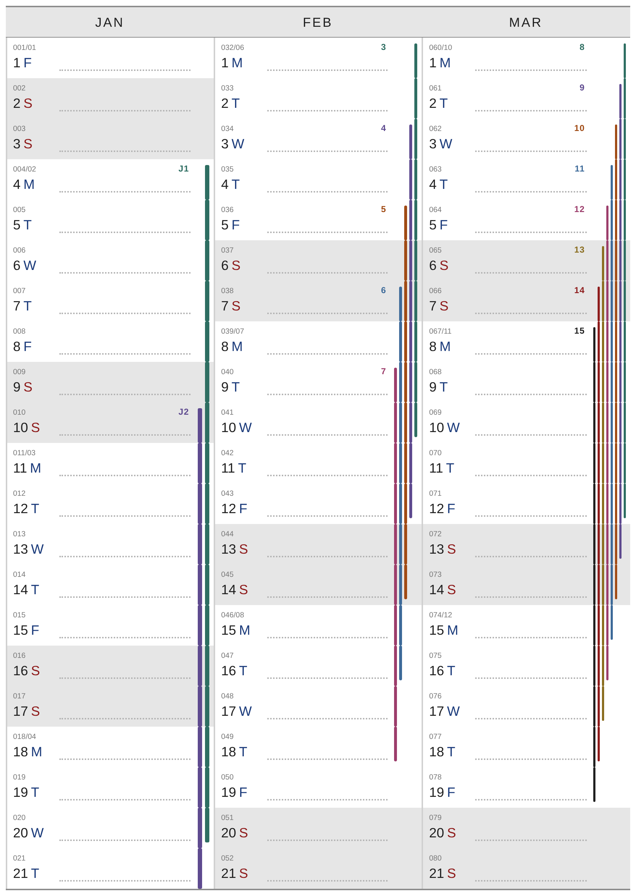 |
| **REQ-PK-6** | A column with no rails reserves only `pad + 0.75 pt` for the rail zone. |

## 7. Flow layout (`--timeline-layout flow`)

| ID | Requirement |
|---|---|
| **REQ-FL-1** | Lanes are computed by one pass over all days of the period (03 §4). Active units keep yesterday's order. |
| **REQ-FL-2** | `daily`: when a unit ends, every unit outside it moves one lane inward the next day. `weekly`: an ended unit leaves an empty lane until the first day of the week (`--week-start`), when all lanes close up. New units fill the innermost empty lane, else enter outermost. 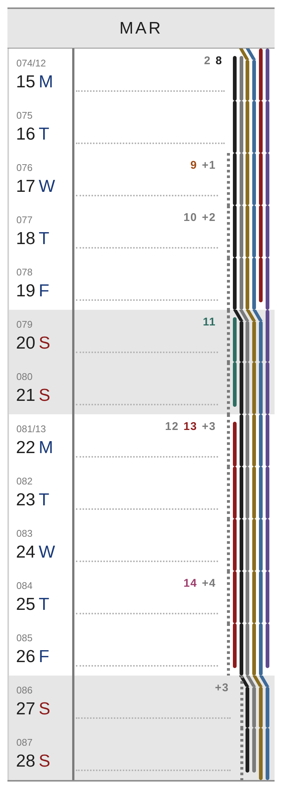 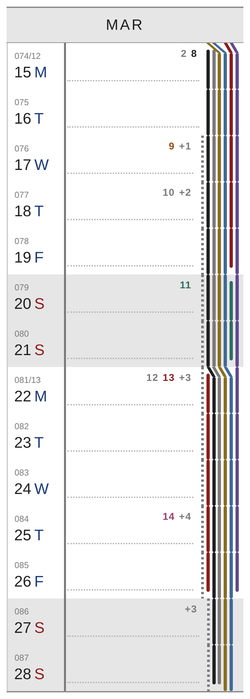 |
| **REQ-FL-3** | A unit that changes lane is drawn with a **jog**: a 4.5 pt tall diagonal at the top of the day it moves, from the old lane to the new, then straight down. No jog on day 1 of a column. |
| **REQ-FL-4** | Per-day width: the note line of each day ends at that day's outermost rail (`pad + n·step + pad`, n = lanes in use that day incl. the overflow rail). Rail width and step are fixed per column from that column's busiest day. |
| **REQ-FL-5** | The lane cap applies: a new unit arriving when all `cap` lanes are busy goes to the overflow rail and **stays there** until it ends. The overflow rail is always the outermost lane. |
| **REQ-FL-6** | Everything else (caps, styles, labels, keys, legend, groups, series, back layer) is the same as in packed. |

## 8. Groups

| ID | Requirement |
|---|---|
| **REQ-GR-1** | When merging is on (§1, REQ-CLI-6), all front intervals with the same `group` form one unit and one rail. The rail is drawn on days where any member is active. 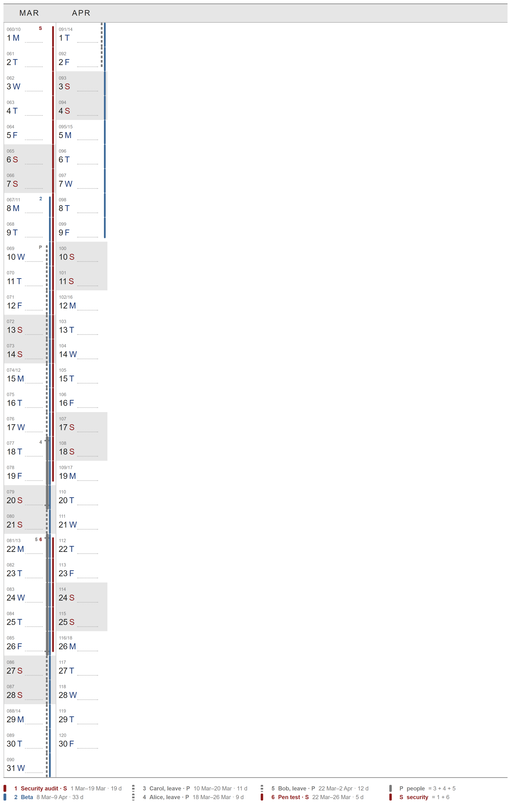 |
| **REQ-GR-2** | One member active: the rail uses that member's colour and style. Two or more: the rail is 0.75 pt thicker, in the colour of the group's first member. |
| **REQ-GR-3** | A member starting or ending while the group rail continues is marked by a tick (rail width + 2.25 pt wide, 1.1 pt tall, 3 pt from the cell edge). |
| **REQ-GR-4** | Group key: the group name's first letter in upper case; on collision, the shortest unique upper-case prefix. Members keep their own numeric keys (REQ-LB-4), which are written on their start days. |
| **REQ-GR-5** | When merging is off, `group` only affects the legend (members marked `· G`) and `length` totals (§10). 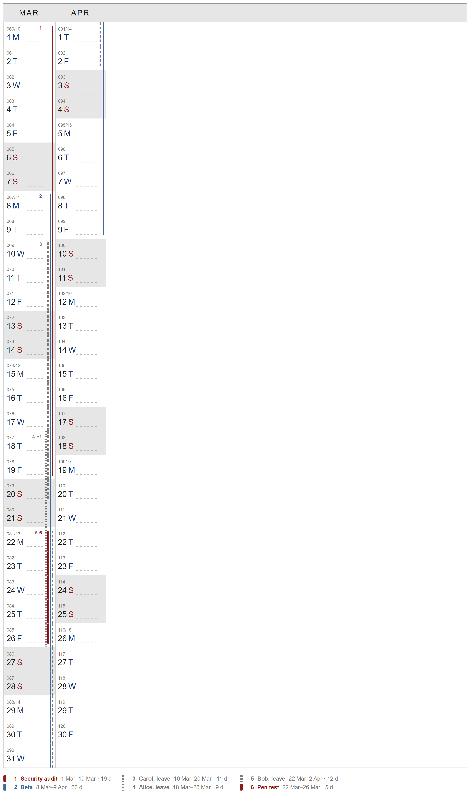 |

## 9. Labels and keys

| ID | Requirement |
|---|---|
| **REQ-LB-1** | Label mode per column: wide page and `k ≤ 3` → **text**; otherwise → **keys**. |
| **REQ-LB-2** | Text mode: each occurrence gets one label per column run, on the first day of the run that has no milestone and no other label, right-aligned in the top row of the note area, upper case, bold, in the interval colour, clipped with `…` before the rail zone. Candidates on one day are taken innermost lane first (back and hatch intervals first). |
| **REQ-LB-3** | Text content: first column of the interval → `TITLE` + ` ?` if tentative + ` · N d|wd` if `length`; later columns → `TITLE (CONT.)`; series → `TITLE #n` on the first occurrence in the column (or every one with `label=each`), `#n` on the others. |
| **REQ-LB-4** | Keys mode: interval keys number the intervals the legend lists (visible, with a day in the period) 1…N by first in-period day, ties in declaration order; hidden and out-of-period intervals have no key. Keys belong to the page: another period can renumber. A key is written on every occurrence's start day; on wide pages also on day 1 of a column for an interval continuing from the previous month (not for series). Keys of one day are right-aligned: back and hatch intervals first, then the rest, each part in ascending key order with group letter keys after the numbers, then the `+N` chip. 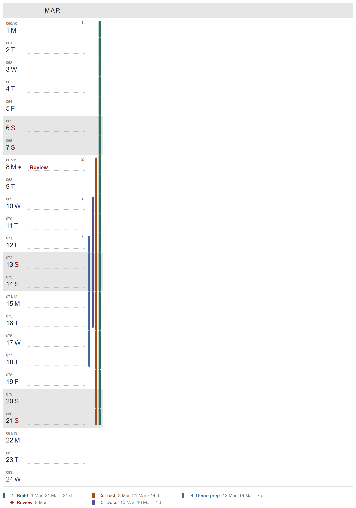 |
| **REQ-LB-5** | Narrow pages: keys only on start days; up to two lines of keys per cell; anything further is clipped (the legend still lists it). |
| **REQ-LB-6** | Labels and keys never overlap rails, never leave their cell, and are never moved to another day to make room. |

## 10. Legend

| ID | Requirement |
|---|---|
| **REQ-LG-1** | The legend sits between the grid's bottom rule and the footer, in 4 equal columns filled column by column, 7.5 pt per row. The grid's row height shrinks to make room; the header and label block do not change. |
| **REQ-LG-2** | One entry per visible declaration with at least one occurrence in the period, sorted by first in-period date. Entry: swatch, key (number, or the milestone glyph), title (+ ` ?`, + ` · back`, + ` · G` group key when merged), grey date text. |
| **REQ-LG-3** | Date text: milestone `d Mon`; interval `d Mon–d Mon · N d` (or `· N wd`) using first day and last drawn day; series `d Mon–d Mon · every 2w · ×8` (first to last in-period occurrence, count of in-period occurrences). |
| **REQ-LG-4** | When groups are merged, one entry per group follows the others: group key, group name, `= 3 + 9 + 11` (member keys, ascending). |
| **REQ-LG-5** | If the grid row height would drop below 6.0 mm, the legend MUST switch to 5 columns with key + title only; if still too tall, the last entry reads `+N more` and the full list is printed to stderr. |
| **REQ-LG-6** | `--timeline-legend off` removes the legend and gives the space back to the grid. |

## 11. Page, footer, metadata

| ID | Requirement |
|---|---|
| **REQ-PG-1** | The label block, header band, title line, month names, weekend shading, out-of-period styling and fonts MUST be unchanged. |
| **REQ-PG-2** | Out-of-period days carry no timeline drawing. |
| **REQ-PG-3** | The footer, when shown, appends ` · timeline: <source names> — N milestones, M intervals · layout: packed|flow` (N, M = declarations, hidden ones included). |
| **REQ-PG-4** | The PDF Subject SHOULD list the source file names; the Creator is unchanged. |
| **REQ-PG-5** | `--font` and the built-in fonts apply to timeline text as well; glyphs ◆ ★ ● MUST render with the chosen font or fall back to drawn vector shapes of the same size. |

## 12. Errors and determinism

| ID | Requirement |
|---|---|
| **REQ-ER-1** | DSL errors and rendering-key errors MUST stop the run before any PDF is written, with exit code 2 and one line per error: `source:line: message`. |
| **REQ-ER-2** | Layout never fails: anything that does not fit is clipped, overflowed or moved to the legend, never an error. |
| **REQ-DT-1** | Same inputs + same `--today` MUST produce the same layout decisions (lanes, overflow, labels, keys, legend), byte-identical to `examples/*.expected.json` when serialized the same way (05). |
| **REQ-DT-2** | No randomness, no dependency on map/hash iteration order, no locale-dependent date maths. |
