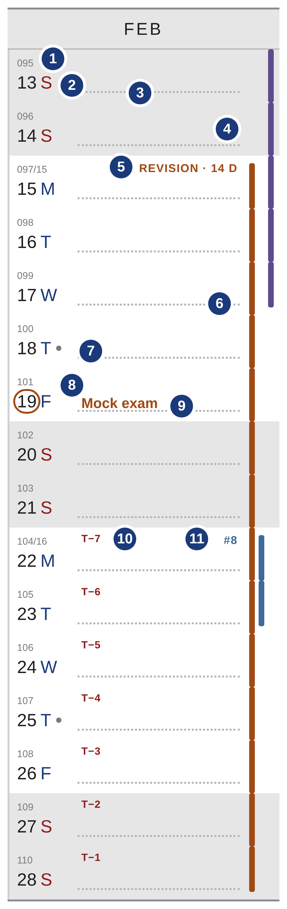
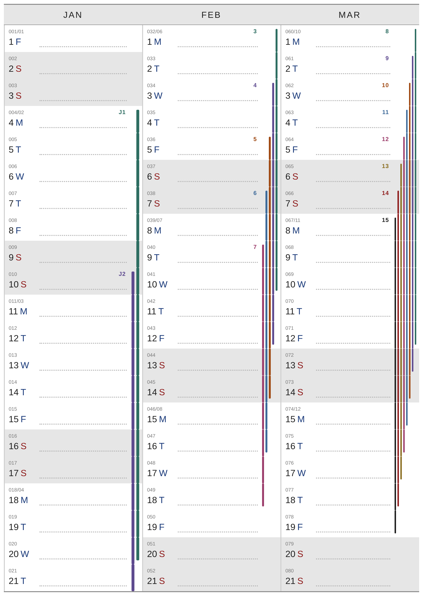
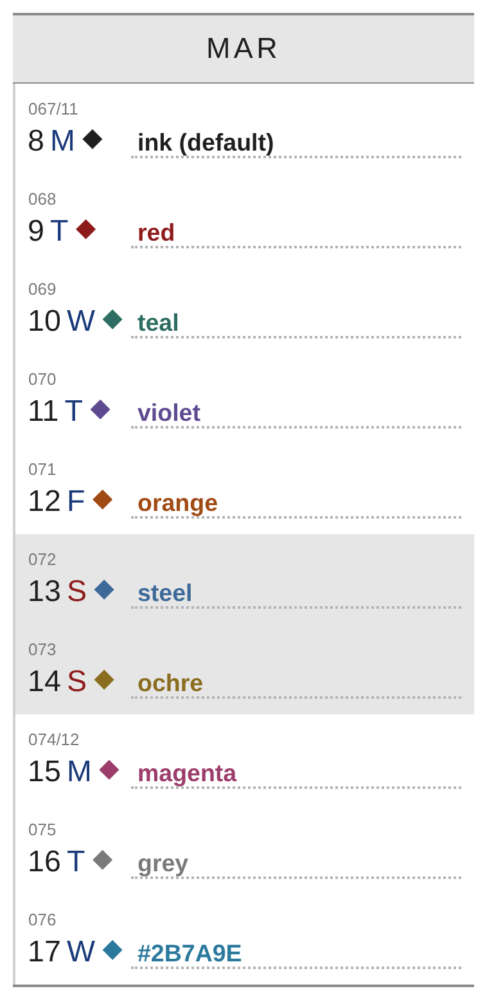
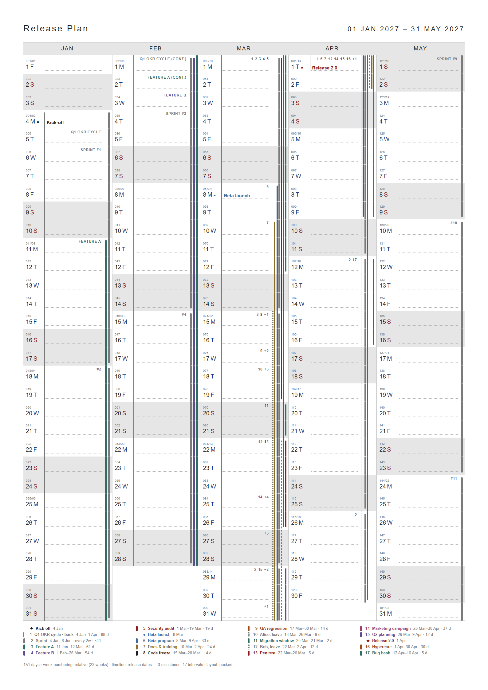
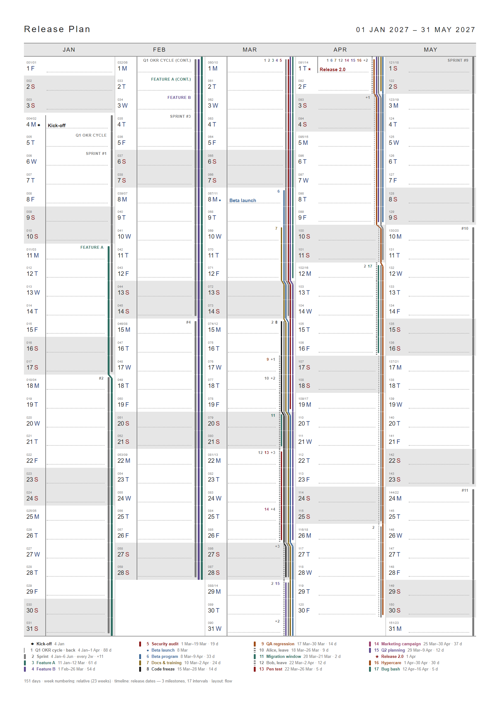
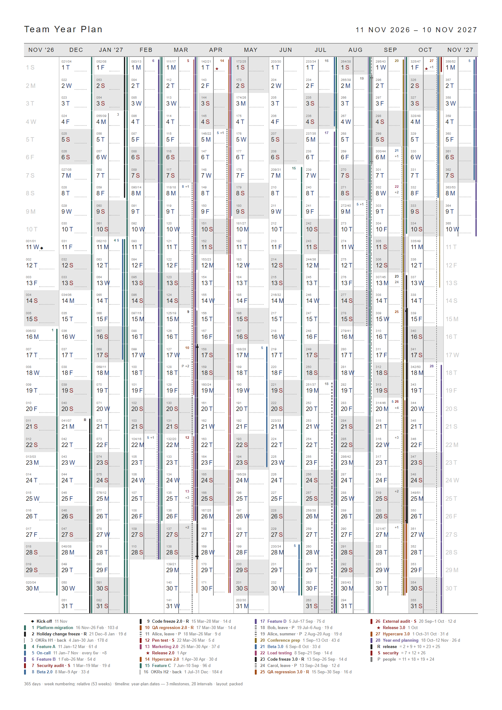
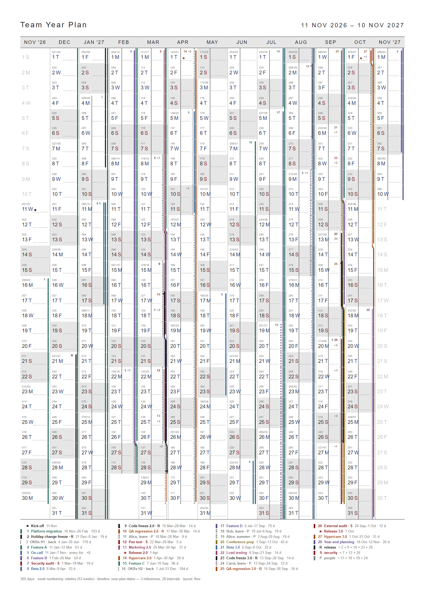
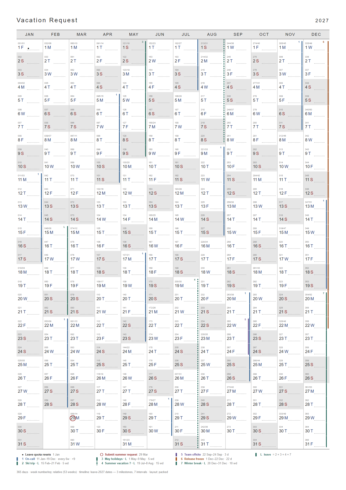

# 02 · Visual guidelines (normative)

All sizes are given in **pt** (PDF user units) with **mm** and the reference renderer's CSS **px** at 96 dpi (1 px = 0.75 pt = 0.2646 mm). Measurements refer to an A4 portrait page with the default 10 mm margin; for other sizes the same pt values apply — only column width changes.

## 1. Principles

1. **The calendar stays the calendar.** Day labels, weekend shading, rules and fonts are untouched. A timeline is drawn on top, in thin strokes, and must leave room to write.
2. **No fills.** Weekend grey is the only cell fill. The one pattern is `style=hatch`.
3. **Right edge for intervals, left for milestones.** Rails stack from the column's right edge inwards; milestone marks and titles start at the left of the note line. Labels sit at the top of the cell, titles on the note line, so the two never collide.
4. **Identity by colour, position and key.** Every drawn interval can be traced to the legend: by its label, or by its key on its start day.
5. **Predictable over clever.** Fixed thresholds, fixed orders, no re-flow between days except in the flow layout, which is opt-in.

## 2. Anatomy of a day cell

| # | Element | Source | Spec |
|---|---|---|---|
| 1 | Tiny `ddd/ww` label | existing | unchanged |
| 2 | Day number + weekday letter | existing | unchanged |
| 3 | Note line (dotted) | existing | ends at the rail zone, §3 |
| 4 | Rail zone | new | `pad + k·step + pad` from the right edge, §3 |
| 5 | Interval text label | new | top row, right-aligned, first free day of the run — REQ-LB-2 |
| 6 | End cap | new | rail stops 3 pt above the cell bottom — REQ-IV-2 |
| 7 | Milestone mark (recurring `dot`, title already shown on 4 Feb) | new | after the weekday letter — REQ-MS-1 |
| 8 | `mark=ring` | new | pill outline around the day number — REQ-MS-2 |
| 9 | Milestone title | new | on the note line — REQ-MS-1 |
| 10 | Countdown `T−7` | new | top-left of the note area — REQ-MS-5 |
| 11 | Series occurrence label `#8` | new | REQ-LB-3 |

Vertical bands inside a cell (cell height is set by the existing layout, ~7.5 mm on A4 with a legend):

| Band | From top | Holds |
|---|---|---|
| Top row | 2.25 pt, line 5.6 pt | interval labels, keys, `+N`, countdown |
| Middle | — | free writing space |
| Note line | 3.75 pt above the bottom | milestone title sits on it; existing dotted guide |
| Label block | existing | day number, weekday letter, mark |

## 3. Rail geometry

Lane positions are measured from the column's right edge: lane *i* has its right side at `pad + i·step`.

| | Wide page (column ≥ 26.5 mm, A4 1–7 cols) | Narrow page (A4 8–13 cols) |
|---|---|---|
| `pad` (edge and inner gap) | 2.25 pt · 0.79 mm · 3 px | 1.5 pt · 0.53 mm · 2 px |
| Lane cap | 6 if column ≥ 31.75 mm (A4 1–5 cols), else 4 | 3 |
| Rail width / step, `k ≤ 4` (wide) · `k ≤ 3` (narrow) | 2.25 / 3.75 pt (3 / 5 px) | 1.5 / 2.6 pt (2 / 3.5 px) |
| Rail width / step, `k ≤ 7` (wide) · `k ≤ 5` (narrow) | 1.5 / 2.6 pt (2 / 3.5 px) | 1.1 / 1.9 pt (1.5 / 2.5 px) |
| Rail width / step, larger `k` | 1.1 / 2.25 pt (1.5 / 3 px) | 0.75 / 1.5 pt (1 / 2 px) |
| Text labels | when `k ≤ 3` | never — keys only |
| Milestone title | on the note line, 5.6 pt | on the note line after the glyph, 4.9 pt |

`k` = lanes shown in the column + 1 when the column has an overflow rail (packed), or the busiest day's lanes incl. overflow (flow).

Other strokes:

| Element | Size |
|---|---|
| End cap inset | 3 pt (4 px) from the cell edge, corner radius 0.75 pt |
| Dashed rail | 2.25 pt dash / 1.5 pt gap |
| Overflow rail | 1.1 pt wide, dotted 1.1 / 1.1 pt, #7A7A7A |
| Margin line (`layer=back`) | 0.75 pt wide, 1.5 pt left of `guideStart`; 2nd/3rd +2.25 pt each, dotted 1.5 / 1.5 pt |
| Group member tick | rail width + 2.25 pt × 1.1 pt, 3 pt from the cell edge |
| Merged group, ≥ 2 members active | rail width + 0.75 pt |
| Flow jog | 4.5 pt tall diagonal at the cell top, same width as the rail |
| Hatch | 135°, 0.75 pt lines every 3.75 pt, #DBDBDB |
| Ring | 0.75 pt pill around the day number, 1 px horizontal padding |

## 4. Colour

The page stays near-monochrome. Timeline colours are dark and of similar lightness, so they read on white and on weekend grey (#E6E6E6) at text sizes and print in greyscale as distinct mid-to-dark greys.

| Name | Hex | Typical use | Contrast on weekend grey #E6E6E6 (worst case) |
|---|---|---|---|
| ink (default) | #1F1F1F | gates, freezes, default | 13.2 : 1 |
| red | #8E1B1B | deadlines, exams, security | 7.2 : 1 |
| teal | #2E6E62 | work streams | 4.8 : 1 |
| violet | #5E4A8F | work streams | 5.9 : 1 |
| orange | #A04A14 | QA, hypercare | 4.8 : 1 |
| steel | #3D6A99 | betas, on-call | 4.5 : 1 |
| ochre | #8A6D1F | docs, preparation | 3.9 : 1 (rails and bold keys only, not titles) |
| magenta | #9C3D6B | marketing, external | 5.1 : 1 |
| grey | #7A7A7A | people out, background | 3.4 : 1 (rails and bold keys only, not titles) |
| `#RRGGBB` | any | — | user's responsibility |

The weekday letter colours (#1A3A7A workday, #8E1B1B weekend) are not in the timeline palette on purpose; `red` equals the weekend colour so deadlines read as "stop".

## 5. Typography

Fonts follow `--font` (default Helvetica). Sizes:

| Text | Size | Weight / case | Colour |
|---|---|---|---|
| Interval label (wide) | 4.5 pt, tracking +0.06 em | bold, UPPER CASE | interval colour |
| Keys (wide) | 4.5 pt | bold | interval colour |
| Keys (narrow) | 4.1 pt, line 5.25 pt, max 2 lines | bold | interval colour |
| `+N` overflow chip | as keys | bold | #7A7A7A |
| Milestone title | 5.6 pt (wide) · 4.9 pt (narrow) | bold | milestone colour |
| Milestone glyph | 4.9 pt (wide, after letter) · 5.25 pt (narrow, on note line) | — | milestone colour |
| Countdown | 4.1 pt, tracking +0.04 em | bold | milestone colour |
| Legend | 4.9 pt; key and title bold, dates regular #7A7A7A | | entry colour |

Clipping uses an ellipsis `…`; text never wraps (except narrow keys, max 2 lines).

## 6. Pages at a glance

| Packed, 5 columns, crowded | Flow, 5 columns, same data |
|---|---|
|  |  |

| Packed, 13 columns, crowded (groups merged) | Flow, 13 columns |
|---|---|
|  |  |

| Packed, 12 columns, light (leave plan) |
|---|
|  |
