# 04 · Scenarios (informative)

Every picture is rendered from the `.dates` file shown with it (`examples/`). Crops are zoomed 2–2.5×. Expected layout decisions for each are in `examples/<name>.expected.json` (see 05).


## Milestones

### Marks

*Options:* `--start 2027-01-01 --period 5m` (5 columns, wide) · *Requirements:* REQ-KEY-3, REQ-MS-1, -2, -4

```text
a = 2027-03-01; title="Diamond (default)"
b = 2027-03-02; title="Star"; mark=star; color=red
c = 2027-03-03; title="Dot"; mark=dot; color=steel
d = 2027-03-04; title="Ring"; mark=ring; color=orange
e = 2027-03-05; title="Two on one day"; color=teal
f = 2027-03-05; title="Second"; mark=dot
```

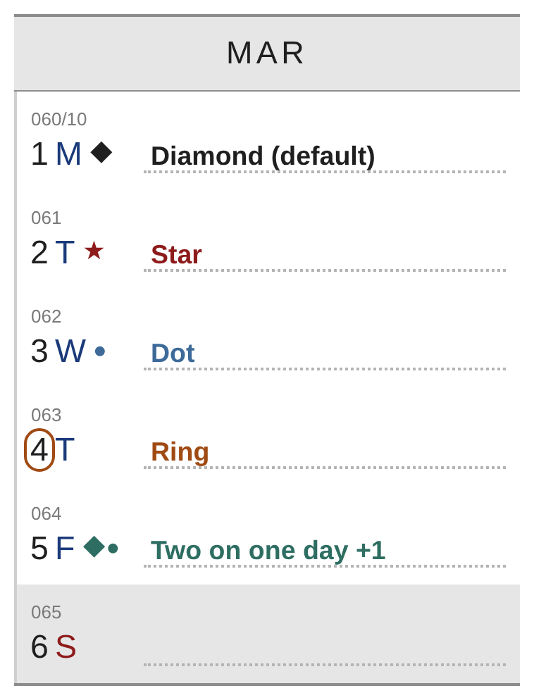

March 1–6. Each mark sits after the weekday letter; `ring` circles the number instead. Two milestones on 5 Mar: both glyphs, one title + ` +1`.

### Named colours

*Options:* `--start 2027-01-01 --period 5m` (5 columns, wide) · *Requirements:* REQ-KEY-2, 02 §4

```text
c1 = 2027-03-08; title="ink (default)"; color=ink
c2 = 2027-03-09; title="red"; color=red
c3 = 2027-03-10; title="teal"; color=teal
c4 = 2027-03-11; title="violet"; color=violet
c5 = 2027-03-12; title="orange"; color=orange
c6 = 2027-03-13; title="steel"; color=steel
c7 = 2027-03-14; title="ochre"; color=ochre
c8 = 2027-03-15; title="magenta"; color=magenta
c9 = 2027-03-16; title="grey"; color=grey
c10 = 2027-03-17; title="#2B7A9E"; color=#2B7A9E
```

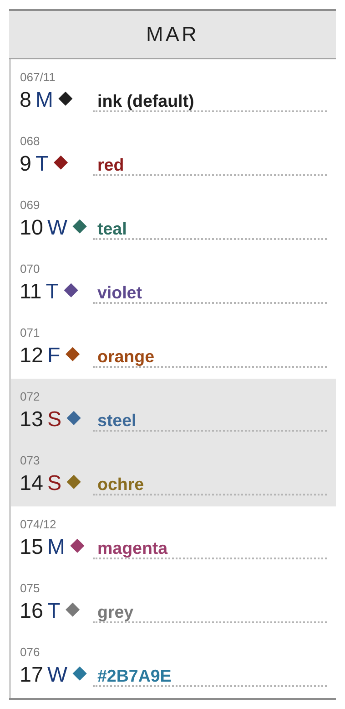

Every palette name plus a `#RRGGBB`, as milestone titles on white and weekend grey.

### Countdown

*Options:* `--start 2027-01-01 --period 5m` (5 columns, wide) · *Requirements:* REQ-KEY-4, REQ-MS-5

```text
exam = 2027-03-12; title="Exam"; mark=star; color=red; countdown=5
```

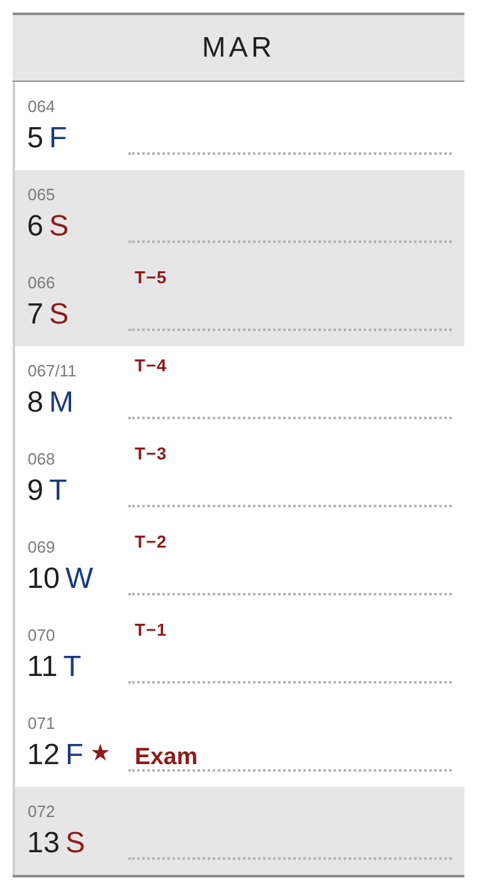

`countdown=5` writes T−5 … T−1 top-left in the five days before the exam.

### Hidden anchor and back-to-back intervals

*Options:* `--start 2027-01-01 --period 5m` (5 columns, wide) · *Requirements:* REQ-KEY-11, REQ-IV-3

```text
term   = 2027-03-08; hide=yes
before = 2027-03-01/@term; title="Before"; color=teal
after  = @term/1w;        title="After"; color=violet
```

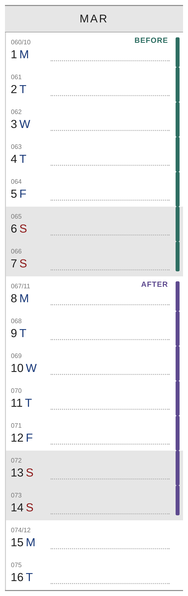

`term` resolves but is not drawn (no mark on 8 Mar). `before` ends the day `after` starts; half-open ranges never share a cell, so they reuse one lane with a visible gap between the caps.


## Intervals

### One interval

*Options:* `--start 2027-01-01 --period 5m` (5 columns, wide) · *Requirements:* REQ-RES-3, REQ-IV-1, -2, REQ-KEY-7

```text
sprint = 2027-03-03/2027-03-10; title="Sprint"; color=teal; length=days
```

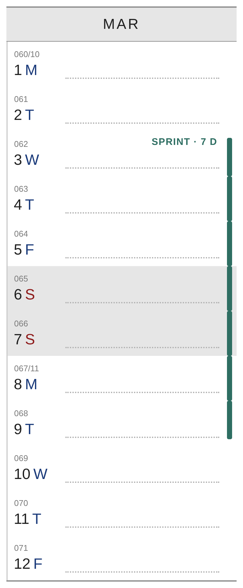

`2027-03-03/2027-03-10` is drawn 3–9 Mar. Rounded caps 3 pt inside the first and last cell. Label on the first day: title + ` · 7 d` from `length=days`.

### Across a month boundary

*Options:* `--start 2027-01-01 --period 5m` (5 columns, wide) · *Requirements:* REQ-IV-4, REQ-LB-3

```text
project = 2027-02-10/2027-03-13; title="Project"; color=violet; length=days
```

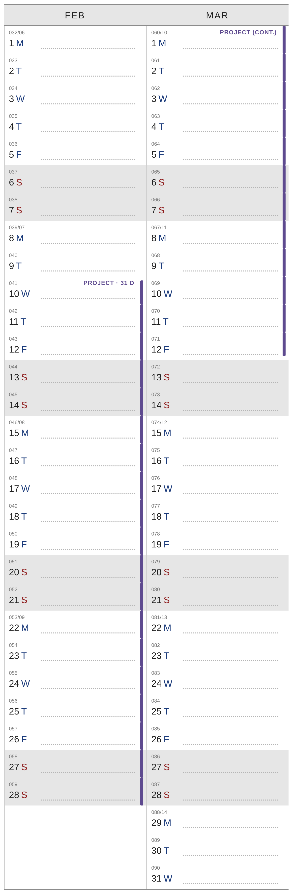

Flat ends at the column break; February shows `PROJECT · 31 D`, March `PROJECT (CONT.)` on its first free day.

### Dashed and tentative

*Options:* `--start 2027-01-01 --period 5m` (5 columns, wide) · *Requirements:* REQ-KEY-5, -6, REQ-IV-6

```text
a = 2027-03-01/1w; title="Dashed"; style=dashed; color=steel
b = 2027-03-09/1w; title="Maybe"; status=tentative; color=teal
```

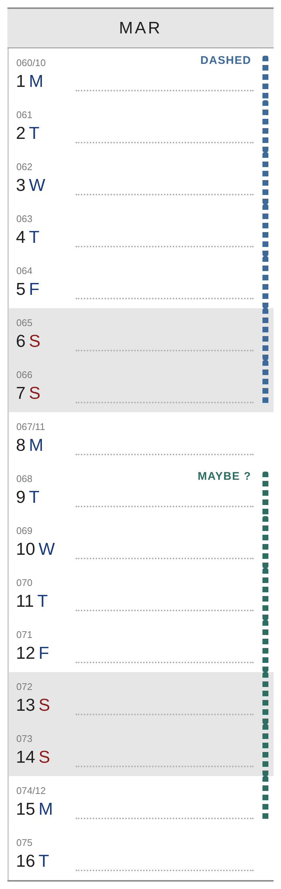

`style=dashed` breaks the rail. `status=tentative` does the same and appends ` ?` to the label and legend.

### Hatch

*Options:* `--start 2027-01-01 --period 5m` (5 columns, wide) · *Requirements:* REQ-IV-7, -8

```text
work     = 2027-03-01/3w;         title="Work"; color=teal
holidays = 2027-03-05/2027-03-15; title="Holidays"; style=hatch
```

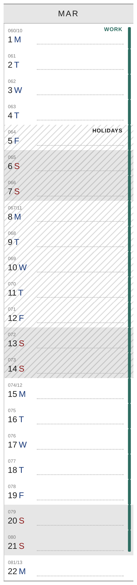

Holidays hatch the covered cells, over weekend grey too; no lane is used, so `Work` keeps lane 0. Hatch is the only cell-wide pattern.

### Background layer

*Options:* `--start 2027-01-01 --period 5m` (5 columns, wide) · *Requirements:* REQ-KEY-8, REQ-IV-10

```text
okr     = 2027-02-15/2027-04-15; title="OKR cycle"; color=grey; layer=back
quarter = 2027-03-01/1m;         title="Budget quarter"; color=steel; layer=back
feature = 2027-03-03/2w;         title="Feature"; color=teal
```

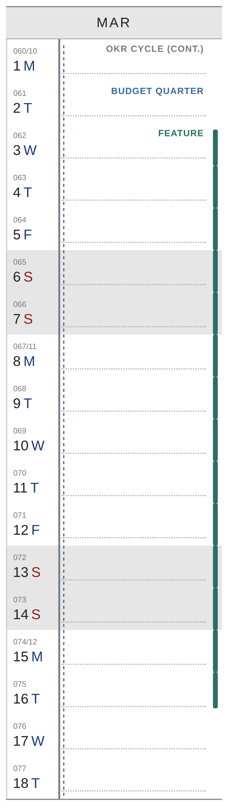

`layer=back` intervals become margin lines between the date and the note line: the first solid, the second dotted. No lane and no fill; `Feature` alone uses the rail zone.


## Packing

### Overlap and first free day

*Options:* `--start 2027-01-01 --period 5m` (5 columns, wide) · *Requirements:* REQ-PK-1, -2, REQ-LB-1, -2

```text
review = 2027-03-08; title="Review"; color=red

build = 2027-03-01/3w; title="Build"; color=teal
test  = 2027-03-08/2w; title="Test"; color=orange
docs  = 2027-03-10/1w; title="Docs"; color=violet
```

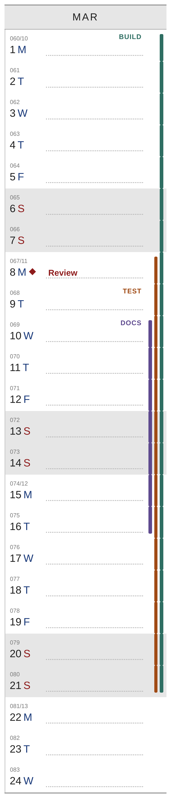

Three overlapping intervals take lanes 0–2. `Test` starts on 8 Mar, which has a milestone, so its label moves to 9 Mar. Three lanes or fewer: text labels.

### Keys instead of labels

*Options:* `--start 2027-01-01 --period 5m` (5 columns, wide) · *Requirements:* REQ-LB-1, -4, REQ-LG-2

```text
review = 2027-03-08; title="Review"; color=red

build = 2027-03-01/3w; title="Build"; color=teal
test  = 2027-03-08/2w; title="Test"; color=orange
docs  = 2027-03-10/1w; title="Docs"; color=violet
demo  = 2027-03-12/1w; title="Demo prep"; color=steel
```

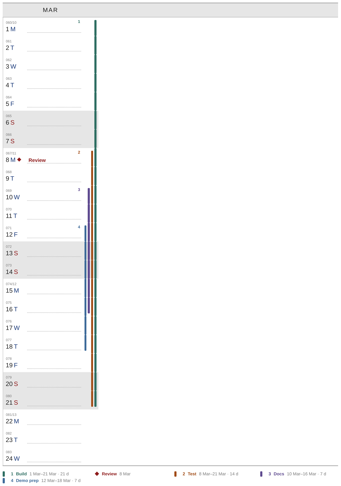

A fourth lane switches the column to keys: the declaration number on each start day; the legend explains them.

### Adaptive rail width

*Options:* `--start 2027-01-01 --period 5m` (5 columns, wide) and `--timeline-lanes 8` · *Requirements:* REQ-PK-5, 02 §3

```text
j1 = 2027-01-04/2027-01-21; title="J1"; color=teal
j2 = 2027-01-10/2027-01-26; title="J2"; color=violet
f1 = 2027-02-01/10d; title="F1"; color=teal
f2 = 2027-02-03/10d; title="F2"; color=violet
f3 = 2027-02-05/10d; title="F3"; color=orange
f4 = 2027-02-07/10d; title="F4"; color=steel
f5 = 2027-02-09/10d; title="F5"; color=magenta
m1 = 2027-03-01/12d; title="M1"; color=teal
m2 = 2027-03-02/12d; title="M2"; color=violet
m3 = 2027-03-03/12d; title="M3"; color=orange
m4 = 2027-03-04/12d; title="M4"; color=steel
m5 = 2027-03-05/12d; title="M5"; color=magenta
m6 = 2027-03-06/12d; title="M6"; color=ochre
m7 = 2027-03-07/12d; title="M7"; color=red
m8 = 2027-03-08/12d; title="M8"; color=ink
```

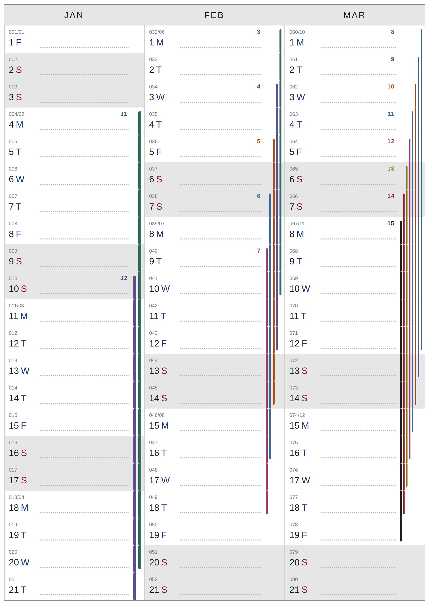

January has 2 lanes (2.25 pt rails), February 5 (1.5 pt), March 8 (1.1 pt). Each column decides alone, so January keeps a wide note area.

### Lane cap, overflow, priority

*Options:* `--start 2027-01-01 --period 5m` (5 columns, wide) · *Requirements:* REQ-KEY-9, REQ-PK-3, -4

```text
i1 = 2027-03-01/10d; title="Infra"; color=teal
i2 = 2027-03-02/10d; title="API"; color=violet
i3 = 2027-03-03/10d; title="Web"; color=orange
i4 = 2027-03-04/10d; title="Mobile"; color=steel
i5 = 2027-03-05/10d; title="Data"; color=magenta
i6 = 2027-03-06/10d; title="Ops"; color=ochre
i7 = 2027-03-07/10d; title="Docs"; color=grey
i8 = 2027-03-08/10d; title="Security"; color=red; priority=high
```

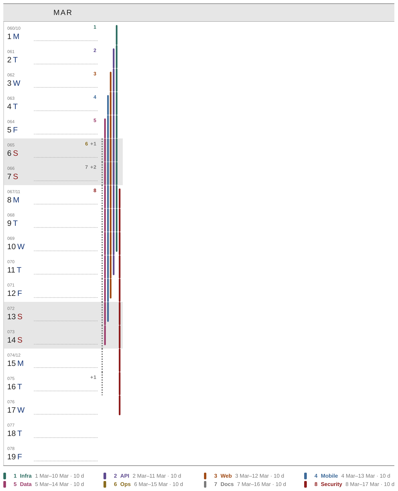

Eight intervals, cap 6. `Security` has `priority=high`, so it is packed first and keeps lane 0; the two latest normal ones (Ops, Docs) share the dotted overflow rail. `+1`, `+2`, `+1` mark where the overflow count changes; their keys still mark their start days.


## Recurrence

### Recurring milestones

*Options:* `--start 2027-01-01 --period 5m` (5 columns, wide) · *Requirements:* REQ-KEY-12, REQ-MS-4, REQ-LB-3

```text
sync    = 2027-01-04; title="Team sync"; every=1w; mark=dot; color=steel
payroll = 2027-01-25; title="Payroll"; every=1m; label=each; color=ochre
```

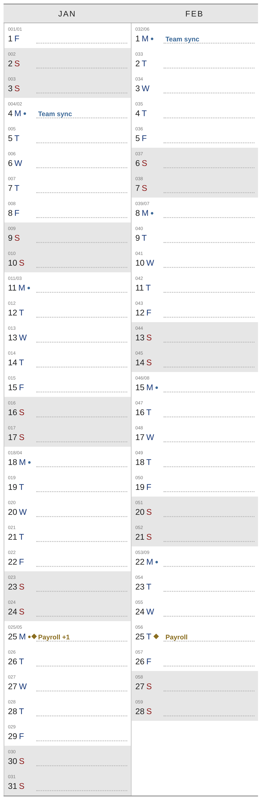

Weekly `Team sync`: a dot every Monday, title only on the first one in each month (`label=first`). Monthly `Payroll` with `label=each`: title every time. On 25 Jan both fall on one day: two glyphs, the title that is due (Payroll) + ` +1`.

### Recurring interval keeps one lane

*Options:* `--start 2027-01-01 --period 5m` (5 columns, wide) · *Requirements:* REQ-PK-1 (series unit), REQ-LB-3

```text
course = 2027-01-04/6w;  title="Course"; color=teal
labs   = 2027-01-11/2d;  title="Lab"; every=2w; count=6; color=steel
```

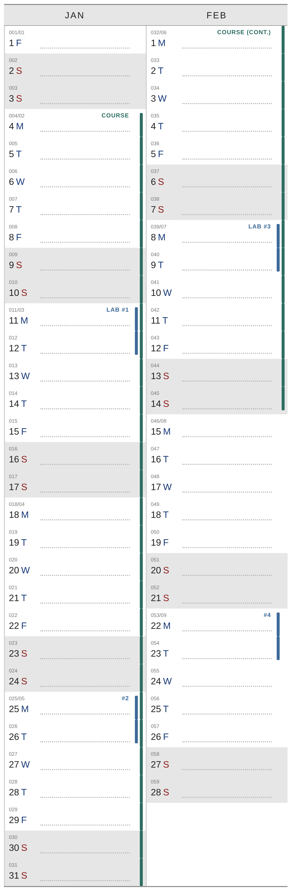

`every=2w; count=6`: six 2-day labs in one lane next to the course. `LAB #1` on the first occurrence in January, `#2` after; February starts again with `LAB #3`.

### Gap-based recurrence

*Options:* `--start 2027-01-01 --period 5m` (5 columns, wide) · *Requirements:* DSL §6.4

```text
shift = 2027-01-04/3d; title="Shift"; gap=2d; count=6; color=violet
```

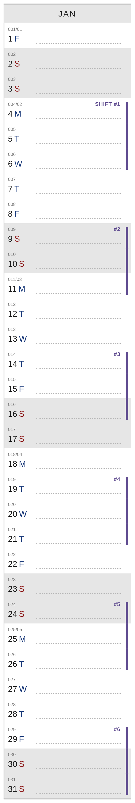

`/3d; gap=2d`: 3 days on, 2 off, independent of weekdays.

### Monthly recurrence clamps

*Options:* `--start 2027-01-01 --period 5m` (5 columns, wide) · *Requirements:* DSL §6.7

```text
report = 2027-01-31; title="Report"; every=1m; count=5; color=red; label=each
```

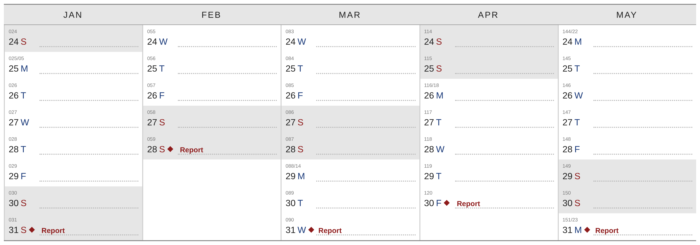

From 31 Jan every month: 28 Feb, 31 Mar, 30 Apr, 31 May — always computed from the original date, so no drift.

### Series whose occurrences overlap

*Options:* `--start 2027-01-01 --period 5m` (5 columns, wide) · *Requirements:* 03 §3

```text
review = 2027-03-01/10d; title="Review"; every=1w; count=4; color=orange
```

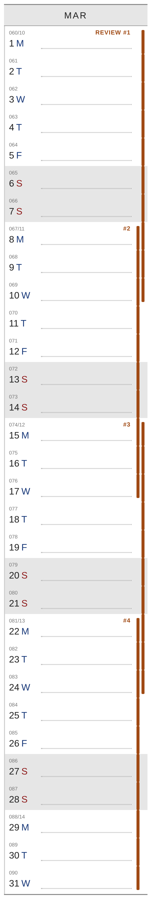

10-day reviews every week overlap; the series splits into sub-units on two adjacent lanes that alternate.


## Narrow pages and groups

### Groups merged (narrow default)

*Options:* `--start 2027-01-01` (12 columns, narrow) · *Requirements:* REQ-GR-1 … -4, REQ-LB-5

```text
carol = 2027-03-10/2027-03-21; title="Carol, leave"; color=grey; style=dashed; group=people
alice = 2027-03-18/2027-03-27; title="Alice, leave"; color=grey; style=dashed; group=people
bob   = 2027-03-22/2027-04-03; title="Bob, leave"; color=grey; style=dashed; group=people
audit = 2027-03-01/2027-03-20; title="Security audit"; color=red; group=security
pen   = 2027-03-22/5d;         title="Pen test"; color=red; group=security
beta  = 2027-03-08/2027-04-10; title="Beta"; color=steel
```

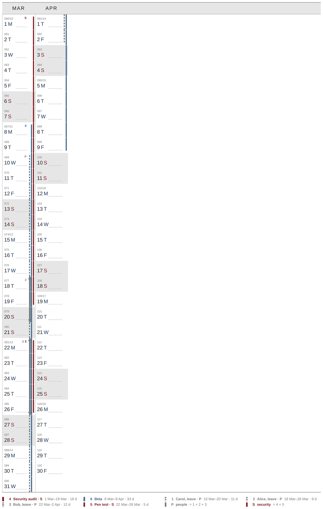

People out (`P`) is one rail: dashed while one person is away, thicker where two overlap, ticks where a member starts or ends inside the run. Security (`S`) breaks between audit and pen test. Member keys appear on their start days.

### Same, `--timeline-groups separate`

*Options:* `--start 2027-01-01` (12 columns, narrow) · *Requirements:* REQ-GR-5, REQ-PK-3

```text
carol = 2027-03-10/2027-03-21; title="Carol, leave"; color=grey; style=dashed; group=people
alice = 2027-03-18/2027-03-27; title="Alice, leave"; color=grey; style=dashed; group=people
bob   = 2027-03-22/2027-04-03; title="Bob, leave"; color=grey; style=dashed; group=people
audit = 2027-03-01/2027-03-20; title="Security audit"; color=red; group=security
pen   = 2027-03-22/5d;         title="Pen test"; color=red; group=security
beta  = 2027-03-08/2027-04-10; title="Beta"; color=steel
```


Without merging March needs 4 units with a cap of 3: an overflow rail and `+1` appear.


## Flow layout

### Packed (default) — for comparison

*Options:* `--start 2027-01-01 --period 5m` (5 columns, wide), 15–28 Mar · *Requirements:* REQ-PK-1

```text
# see examples/release.dates (full file, 3 milestones and 17 intervals)
```

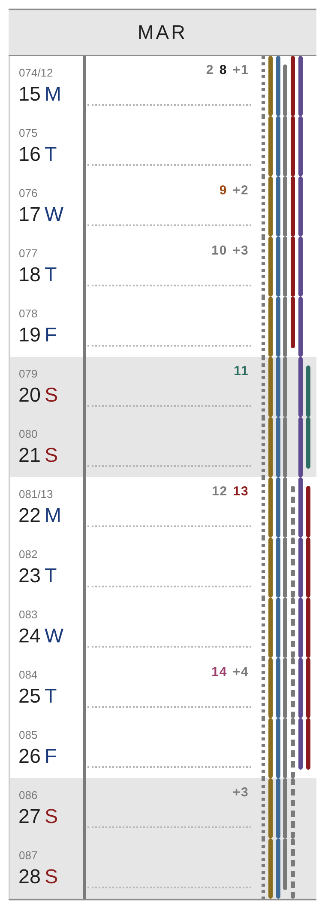

Lanes never move; when an inner interval ends its lane stays empty until reused.

### Flow, daily

*Options:* `--start 2027-01-01 --period 5m` (5 columns, wide) and `--timeline-layout flow` · *Requirements:* REQ-FL-1 … -4

```text
# see examples/release.dates (full file, 3 milestones and 17 intervals)
```

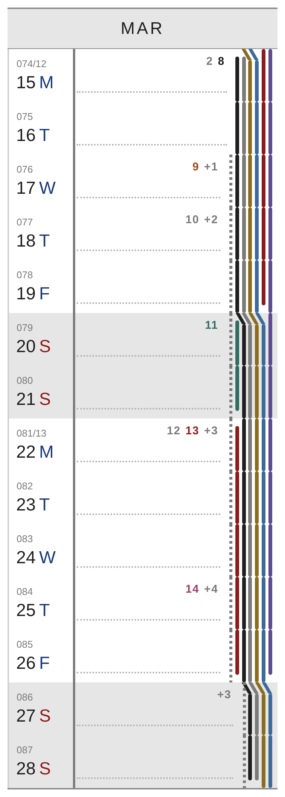

Rails outside an ended one slide inward the next day with a short diagonal; the note line of each day ends at that day's outermost rail.

### Flow, weekly compaction

*Options:* `--start 2027-01-01 --period 5m` (5 columns, wide) and `--timeline-layout flow --timeline-compact weekly` · *Requirements:* REQ-FL-2

```text
# see examples/release.dates (full file, 3 milestones and 17 intervals)
```

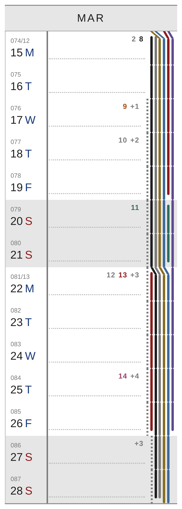

Gaps stay until Monday (15 and 22 Mar), then everything closes up at once: fewer diagonals.


## Period edges

### Clipped by the period

*Options:* `--start 2027-01-15 --period 5m` (6 columns) · *Requirements:* REQ-IV-5, REQ-PG-2

```text
pre  = 2027-01-05/2027-01-25; title="Started earlier"; color=teal; length=days
post = 2027-06-01/2027-07-01; title="Ends later"; color=violet; length=days
```

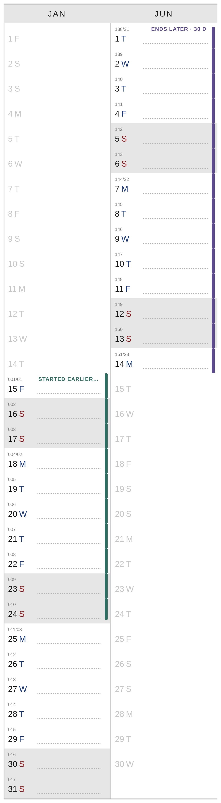

An interval that began before the period starts flush on 15 Jan; one that ends after it stops flush on 14 Jun. Lengths and legend use the full intervals. Out-of-period days stay faint and empty.


## Full pages

| Picture | Input | Options |
|---|---|---|
| 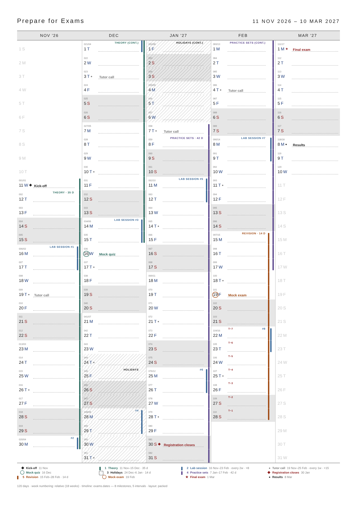 | `exams.dates` | `--start 2026-11-11 --period 120d --title "Prepare for Exams" --today 2026-11-11` |
| 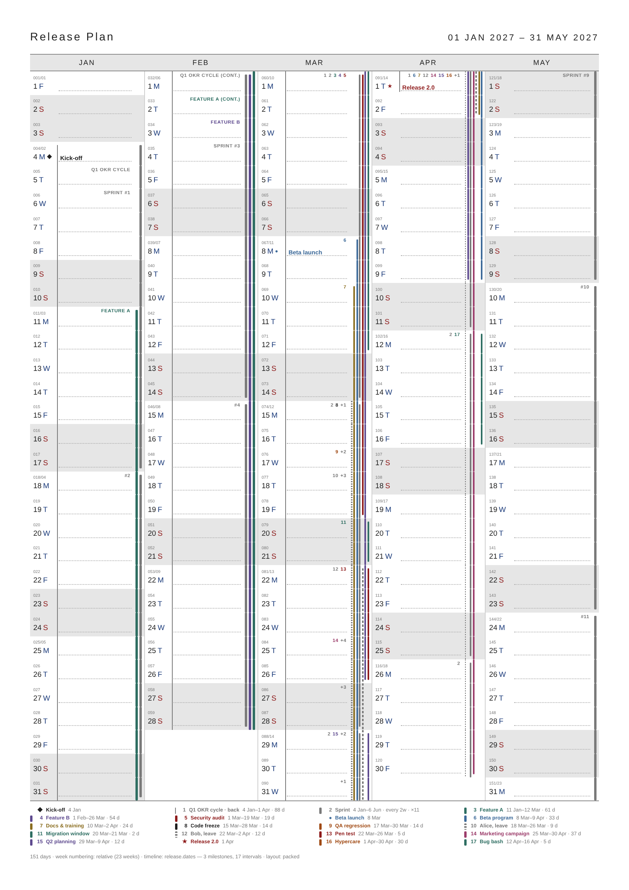 | `release.dates` | `--start 2027-01-01 --period 5m` |
| 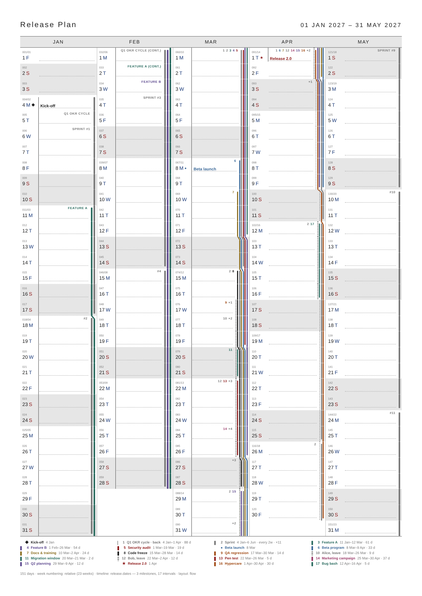 | `release.dates` | same + `--timeline-layout flow` |
| 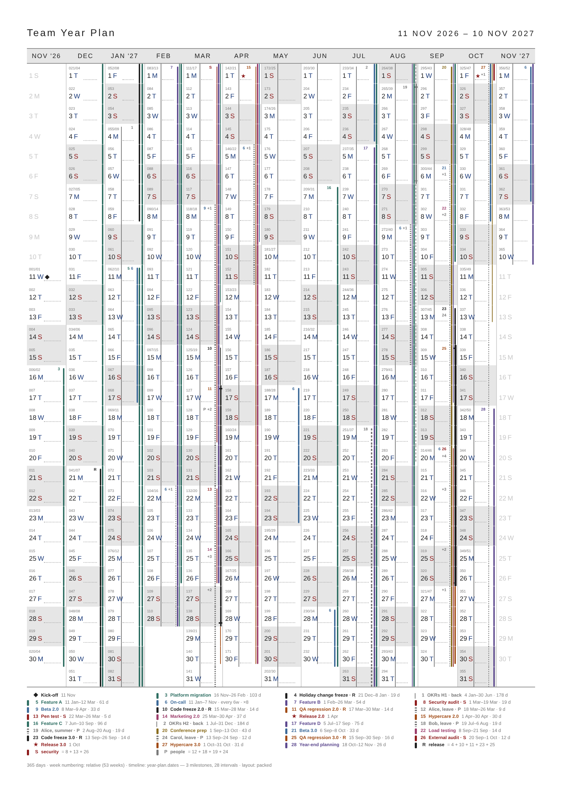 | `year-plan.dates` | `--start 2026-11-11 --period 1y` (13 columns; groups merged by default) |
| 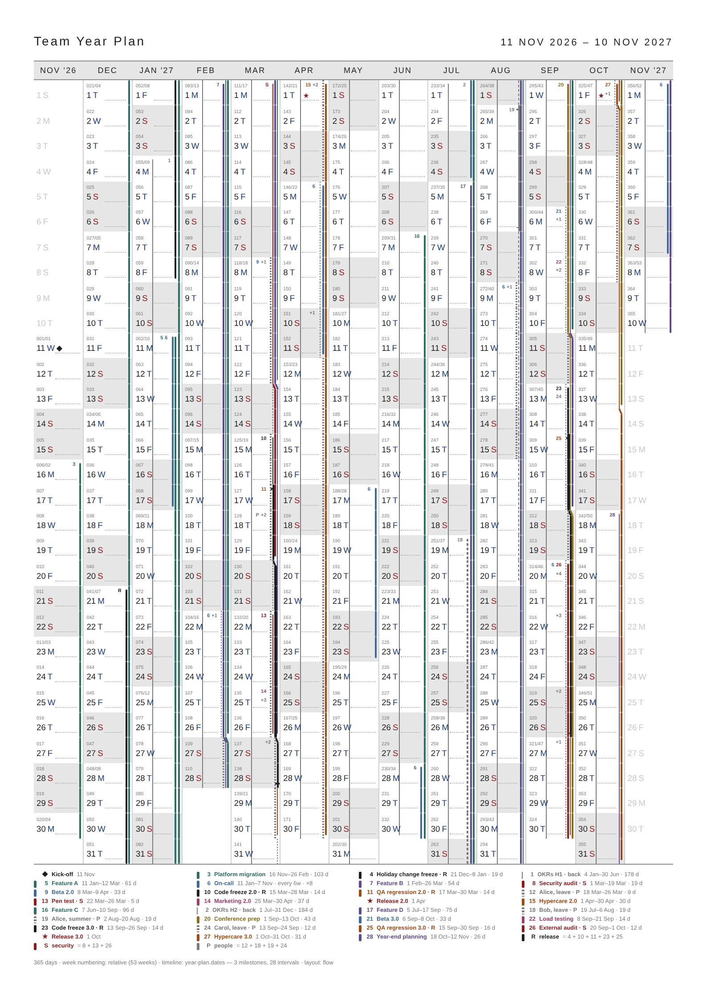 | `year-plan.dates` | same + `--timeline-layout flow` |
| 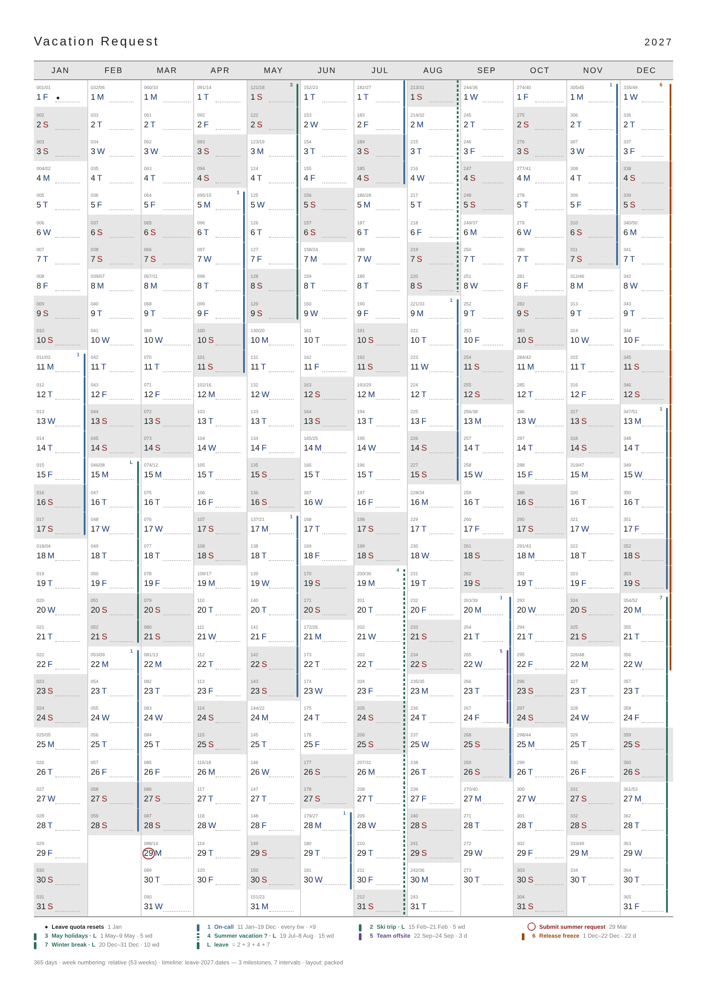 | `leave-2027.dates` | `--start 2027-01-01` (12 columns) |
