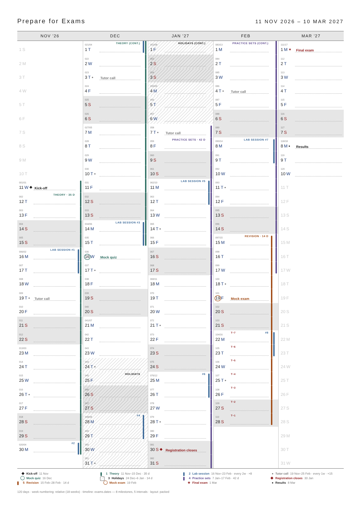

# Timeline on the calendar — milestones, intervals, recurrence

Design guidelines and implementation requirements for drawing Date DSL timelines on the yearly-calendar PDF page.

**Status:** final for implementation (v1). Scope: the **packed** layout (default) and the **flow** layout.
**Applies to:** the Go program in `go/` (go-pdf/fpdf). The design was written while a Python version also existed; that version was retired in 0.2.0, so wherever these documents say "both implementations" or "Go and Python", read "the Go program". The golden files remain the contract.
**Depends on:** [Date DSL Specification](date-dsl-specification.md) (Phase 1 with recurrence). That document defines the syntax, resolution and errors for dates; this one defines everything that happens after the dates are resolved.

## Reading order

| File | Kind | What it holds |
|---|---|---|
| [IMPLEMENTATION.md](IMPLEMENTATION.md) | Plan | Step-by-step build order for the coding agent, each step tied to requirements and tests. |
| [01-requirements.md](01-requirements.md) | **Normative** | Numbered requirements (`REQ-…`) — CLI, rendering keys, drawing rules, layouts, legend, errors. MUST/SHOULD/MAY as in RFC 2119. |
| [02-visual-guidelines.md](02-visual-guidelines.md) | **Normative** | Geometry, sizes in pt/mm, colours, typography, and the anatomy of a day cell, with pictures. |
| [03-layout-algorithms.md](03-layout-algorithms.md) | **Normative** | Pseudocode for lane packing, overflow, flow lanes, labels, keys and the legend. |
| [04-scenarios.md](04-scenarios.md) | Informative | One picture per setting, property and case, each with its `.dates` input and what to look for. |
| [05-acceptance.md](05-acceptance.md) | Normative | Test matrix, golden files, visual checks — the definition of done. |
| [90-decisions.md](90-decisions.md) | Informative | Options considered and rejected, and why. Open items. |
| [date-dsl-specification.md](date-dsl-specification.md) | Normative (input) | The Date DSL spec this feature consumes, copied for convenience. |
| `examples/` | Test data | Every `.dates` fixture used in the pictures, plus `*.expected.json` golden layout decisions. |
| `img/` | Pictures | Rendered from the fixtures by the reference renderer. |
| `reference/` | Informative | The reference renderer (plain JS) that drew every picture and wrote every golden file. |

If a picture and a requirement disagree, **the requirement wins**; report the mismatch.

## The feature in one picture



*`examples/exams.dates` on an A4, 5-column page: milestones (◆ ★ ● and a ring around the date), intervals as thin rails on the right edge of each column, a weekly series (Tutor call), a fortnightly series (Lab session #1–#8), a hatched holiday, a countdown before the exam, and the legend above the footer.*

## Key decisions (one line each)

1. Weekend shading stays the **only** cell fill. Timelines never tint a cell; the one pattern allowed is `style=hatch`.
2. Intervals are **rails** stacked from the column's right edge inwards; milestones are a **mark** after the weekday letter plus a title on the note line.
3. Lanes are packed **per column** (month), so quiet months keep their full writing space.
4. Rails get **thinner** as lanes increase; beyond a **lane cap** intervals share one dotted **overflow rail** with a `+N` count.
5. When a column has more than 3 lanes (or the page has 8+ columns) text labels give way to **numeric keys**, explained by the legend.
6. On narrow pages (8–13 columns) intervals with the same `group=` share one rail.
7. `layer=back` draws long, low-attention intervals as a 1 px **margin line** instead of a rail.
8. **Flow** layout (opt-in): rails slide inward when an inner one ends; the note line follows each day's outermost rail.
9. A recurring series keeps **one lane**; its title appears once per column, then `#n`.
10. Everything is deterministic: same input + `--today` → same PDF, in Go and in Python.

## Regenerating pictures and golden files

```bash
cd docs/timeline/reference
python3 render.py            # all pictures → ../img/*.png   (needs Playwright + Chromium)
node golden.js               # all ../examples/*.expected.json
```
